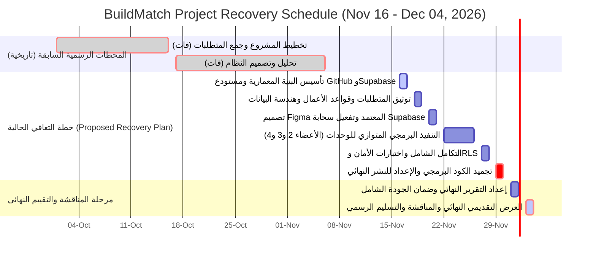

# BuildMatch — المخطط الزمني وخطة التعافي (Gantt Chart & Recovery Schedule)

> **تنويه تاريخي وإداري:**  
> التاريخ الحالي هو **16 نوفمبر 2026**.  
> محطات التسليم الرسمية السابقة لـ DEPI كانت كالتالي:
> - **16 أكتوبر 2026:** التخطيط والمراجعة الأدبية وجمع المتطلبات (تاريخ انقضى ولم يتم اعتماده رسميًا في حينه).
> - **06 نوفمبر 2026:** التحليل والتصميم الهندسي للنظام (تاريخ انقضى).
> 
> تم إعداد هذا الجدول كـ **خطة تعافي مقترحة ومكثفة (Proposed Recovery Plan)** لإنهاء كامل المتطلبات البرمجية والتسليم النهائي قبل المواعيد النهائية الرسمية:
> - **30 نوفمبر 2026:** الموعد النهائي لاكتمال التنفيذ البرمجي (Implementation Deadline).
> - **04 ديسمبر 2026:** العرض التقديمي النهائي ومناقشة المشاريع وتسليم التقارير (Final Presentation & Submission).

---

## 1. المخطط الزمني لخطة التعافي (Mermaid Gantt Chart)

---

## 2. تفصيل مراحل خطة التعافي (Recovery Phases Breakdown)

| المرحلة الزمنية | التواريخ | نطاق العمل والمخرجات المستهدفة | المسؤول |
| :--- | :--- | :--- | :--- |
| **المرحلة 1** | 16–17 نوفمبر 2026 | تأسيس بنية React وVite، هيكل المشروع، ربط عميل Supabase، بناء الهجرات الأربع، سياسات الأمان، وتكوين Git/GitHub CI. | قائد المشروع |
| **المرحلة 2** | 18–19 نوفمبر 2026 | استكمال ملفات التوثيق الرسمية لـ DEPI (المتطلبات، المخططات، عقود الربط، قواميس البيانات). | الفريق كاملاً |
| **المرحلة 3** | 20–21 نوفمبر 2026 | إنجاز نظام التصميم في Figma لجميع الشاشات وتجهيز بيانات الاختبار المحلية والسحابية. | قائد المشروع |
| **المرحلة 4** | 22–26 نوفمبر 2026 | التنفيذ البرمجي التفرعي المستقل للواجهات الأمامية: وحدة المالك، وحدة المقاول، وحدة التنفيذ ولوحة الإدارة. | الأعضاء 2، 3، 4 |
| **المرحلة 5** | 27–28 نوفمبر 2026 | دمج الفروع في `develop`، اختبارات التكامل مع Supabase، فحص تدفقات RLS ومنع الثغرات. | قائد المشروع والفريق |
| **المرحلة 6** | 29–30 نوفمبر 2026 | تجميد إضافة ميزات جديدة (Code Freeze)، النشر التجريبي على Vercel، وفحص مؤشرات الأداء. | قائد المشروع |
| **المرحلة 7** | 1–2 ديسمبر 2026 | إعداد ملفات التقرير النهائي ودليل المستخدم والمطابقة مع متطلبات لجان تقييم DEPI. | الفريق كاملاً |
| **المرحلة 8** | 3–4 ديسمبر 2026 | التجهيز للعرض التقديمي الحي والمناقشة النهائية الرسمية. | الفريق كاملاً |
