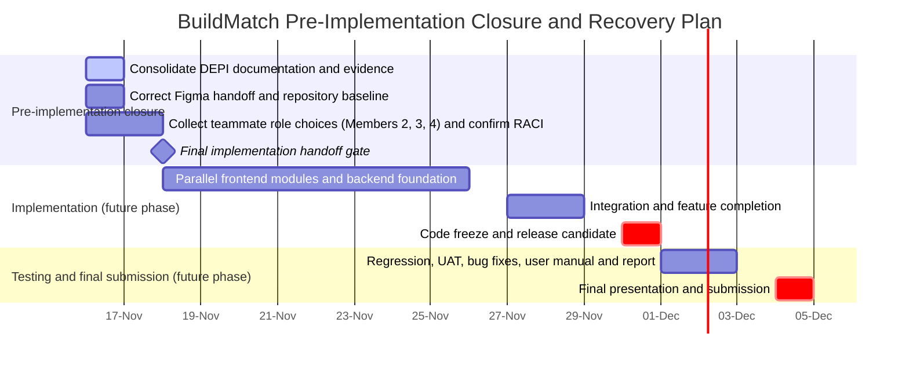

# BuildMatch — Gantt Chart & Recovery Schedule

> **Important Note on Module Allocation:**  
> Module ownership for Member 2, Member 3, and Member 4 is intentionally unassigned until the team confirms its preferred allocation. No module assignment should be inferred from older documentation.

**Status date:** 2026-11-16  
**Note:** DEPI dates below are official target dates from the supplied guideline. Recovery dates are team proposals, not DEPI-issued extensions.

## 1. Official DEPI milestones

| Deliverable | Official DEPI target |
|---|---:|
| Project Planning & Management | 2026-10-16 |
| Literature Review | 2026-10-16 |
| Requirements Gathering | 2026-10-16 |
| System Analysis & Design | 2026-11-06 |
| Implementation (Source Code & Execution) | 2026-11-30 |
| Final Presentation, Testing & Reports | 2026-12-04 |

## 2. Recovery Gantt

## 3. Current stop point

The current work is limited to the pre-implementation closure tasks. The proposed 2026-11-18 kickoff is a team proposal conditional on Member 2, Member 3, and Member 4 selecting their preferred module roles, repository access/branch synchronization, and Figma/API handoff review. If the gate is not met, the team lead must update the recovery schedule rather than silently treating the kickoff as completed.

## 4. Resource allocation

- Project Leader: planning, architecture, Supabase foundation, Figma, shared contracts, integration oversight.
- Landowner UI owner: landowner frontend module (Member 2, 3, or 4 - to be selected).
- Contractor UI owner: contractor frontend module (Member 2, 3, or 4 - to be selected).
- Execution/Admin UI owner: execution and admin frontend modules (Member 2, 3, or 4 - to be selected).
- All members: onboarding, module review, integration, responsive/RTL QA, regression, and final presentation contributions.

Module ownership for Member 2, Member 3, and Member 4 is intentionally unassigned until the team confirms its preferred allocation. No module assignment should be inferred from older documentation.
