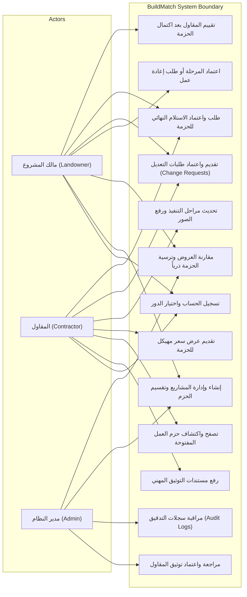

# BuildMatch — مخطط وحالات الاستخدام (Use Case Diagram & Descriptions)

## 1. مخطط حالات الاستخدام الشامل (Mermaid Use Case Diagram)

---

## 2. تفصيل أهم حالات الاستخدام الرئيسية

### حالة الاستخدام: UC07 — ترسية حزمة العمل ذرياً (Award Work Package)
- **الفاعل الرئيسي:** مالك المشروع (Landowner).
- **الشروط المسبقة:** 
  1. المشروع وحزمة العمل منشوران بحالة `open` أو `under_review`.
  2. وجود عرض واحد على الأقل بحالة `submitted`.
  3. المالك قد سجل دخوله ومصادقته متطابقة مع `owner_id`.
- **التدفق الرئيسي للخطوات (Main Flow):**
  1. يفتح المالك صفحة تفاصيل حزمة العمل وجدول مقارنة العروض.
  2. يراجع المالك الأسعار والمواد والمدد وجداول الدفعات.
  3. يضغط المالك على زر "ترسية الحزمة على هذا العرض".
  4. تظهر نافذة تأكيد تحذر من أن الترسية عملية نهائية وستغلق التنافس للحزمة.
  5. يؤكد المالك، فيرسل النظام استدعاء RPC للدالة `select_contractor_for_package`.
  6. تقفل قاعدة البيانات سجل الحزمة، وتقبل العرض الفائز، وترفض بقية العروض تلقائياً، وتحدث حالة الحزمة إلى `assigned`.
  7. تظهر رسالة نجاح خضراء ويتم توجيه المالك لمتابعة خطة مراحل التنفيذ.
- **التدفقات البديلة / الاستثنائية:**
  - إذا حاول مستخدم آخر أو مقاول الترسية، ترفض قاعدة البيانات فوراً بكود خطأ 42501 (RLS Unauthorized).
  - إذا تم إسناد الحزمة في نفس اللحظة من جلسة أخرى، ترفض العملية وتظهر رسالة "الحزمة قيد الترسية مسبقاً".
