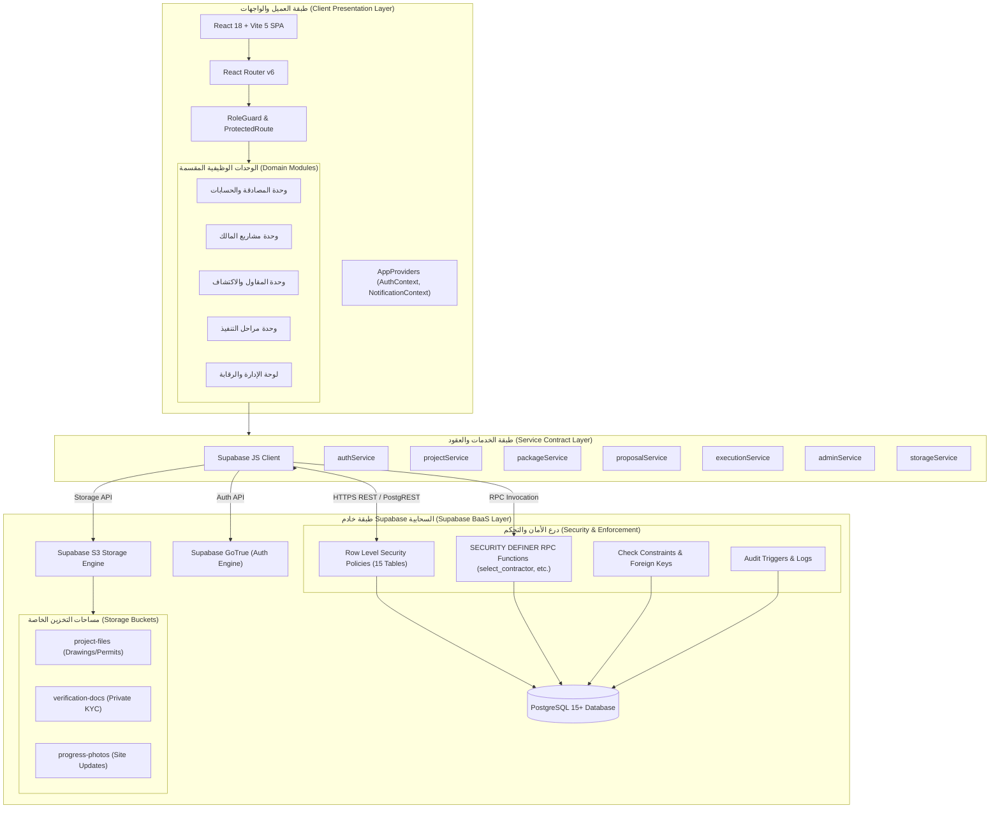

# BuildMatch — البنية المعمارية ومخطط النظام (Architecture Description & Diagram)

## 1. النمط المعماري المعتمد: Modular Monolith
تم تصميم BuildMatch وفق نمط **الأحادي المعياري (Modular Monolith)**:
- **تطبيق واجهة أمامية موحد (Single React Application):** يضم تجارب وأدوار المستخدمين الثلاثة (المالك، المقاول، ومدير النظام) داخل نفس شجرة المكونات وموجّه الصفحات (React Router)، مع ضبط الصلاحيات عبر حواجز حماية مركزية (`RoleGuard` و`ProtectedRoute`).
- **بنية خدمات وبيانات موحدة (Single Supabase PostgreSQL Backend):** مشروع واحد وقاعدة بيانات علائقية واحدة تضمن تكامل المعاملات (ACID Transactions) والربط المرجعي الصارم، مع تفويض الأمان بالكامل لطبقة قاعدة البيانات عبر Row Level Security (RLS).

---

## 2. المخطط المعماري الشامل (Mermaid Architecture Diagram)

---

## 3. القرارات المعمارية الرئيسية (Architecture Decision Records — ADRs)
1. **رفض تجزئة التطبيق إلى 3 تطبيقات منفصلة:** بدلاً من بناء تطبيق منفصل للمالك وآخر للمقاول وثالث للمدير، تم دمجهم في تطبيق موحد لتبسيط دورة النشر، وإعادة استخدام مكتبة المكونات المشتركة، وتفادي مشاكل مشاركة الكود ومزامنة النسخ.
2. **الاعتماد على RLS بدلاً من حماية الواجهات فقط:** حماية الأزرار والروابط في الواجهة الأمامية تحسن تجربة المستخدم فقط، بينما يعتمد الأمان الحقيقي لمنع قراءة أو تعديل البيانات على سياسات PostgreSQL RLS الصارمة.
3. **اعتماد RPC للترسية واعتماد المراحل:** استدعاء العمليات الحساسة متعددة الجداول من خلال دوال قاعدة بيانات مخزنة ومحمية بصلاحيات `SECURITY DEFINER` تضمن حماية الحسابات من التلاعب والحفاظ على اتساق السجلات عبر قفل الصفوف (Row Locking).
