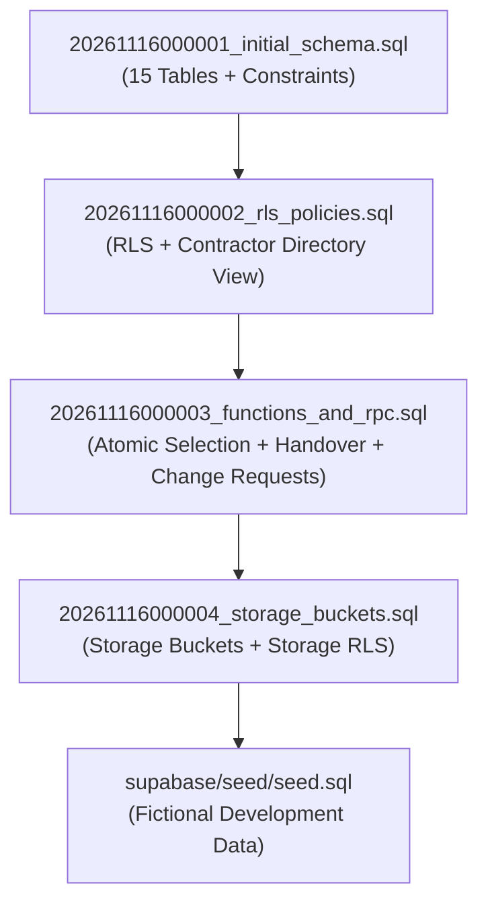

# BuildMatch — Database Migration & Deployment Guide

**Document Version:** 1.0.0  
**Target Platform:** PostgreSQL 15+ / Supabase Backend  
**Author:** Mahmoud El Sayed (Project Leader & System Architect)  
**Date:** 2026-11-16  

---

## 1. Migration Overview & Sequence

BuildMatch database migrations follow a strictly ordered, idempotent sequence located in `supabase/migrations/`:

```
supabase/migrations/
├── 20261116000001_initial_schema.sql      (Core entities, constraints, triggers, indexes)
├── 20261116000002_rls_policies.sql        (Row Level Security & privacy views)
├── 20261116000003_functions_and_rpc.sql   (Transactional stored procedures & RPC)
└── 20261116000004_storage_buckets.sql     (Storage bucket configurations & storage RLS)

supabase/seed/
└── seed.sql                               (Fictional test dataset for local evaluation)
```

### Execution Order Dependency Graph



---

## 2. Migration Breakdown

### Migration 01: `20261116000001_initial_schema.sql`
- **Purpose:** Initializes core database schema and constraints.
- **Extensions:** `uuid-ossp`, `pgcrypto`.
- **Tables (15):**
  1. `profiles`: Extends `auth.users` with roles (`landowner`, `contractor`, `admin`), phone, city.
  2. `contractor_profiles`: Business details, specializations array, verification status.
  3. `verification_documents`: Contractor regulatory document metadata.
  4. `projects`: Landowner residential projects.
  5. `project_files`: Project drawings, permits, soil reports.
  6. `project_packages`: Work packages with status lifecycle.
  7. `proposals`: Contractor commercial bids.
  8. `proposal_items`: Granular bill of quantities (BOQ).
  9. `milestones`: Construction phase tracking.
  10. `progress_updates`: On-site progress posts with photos.
  11. `change_requests`: Formal scope/cost/time variance requests.
  12. `reviews`: Post-completion contractor performance ratings.
  13. `notifications`: In-app event alerts.
  14. `reports`: Moderation dispute records.
  15. `audit_logs`: Immutable security audit trail.
- **Triggers:** Automatic `updated_at` management across all tables.

### Migration 02: `20261116000002_rls_policies.sql`
- **Purpose:** Enables 100% Row Level Security across all 15 public tables.
- **Hardening:**
  - Profiles `USING (true)` completely eliminated; restricted to self, admin, and active project partners.
  - Creates `public.contractor_public_directory` view (stripping phone numbers and internal notes).
  - Creates `public.get_public_contractor_profile(UUID)` RPC with `SECURITY DEFINER`.

### Migration 03: `20261116000003_functions_and_rpc.sql`
- **Purpose:** Atomic stored procedures for business operations requiring atomic transactions.
- **Functions:**
  1. `select_contractor_for_package`: Awards package, rejects rivals, verifies contractor approval status.
  2. `request_package_handover`: Contractor initiates project handover.
  3. `approve_package_completion`: Landowner confirms completion, triggers final review eligibility.
  4. `decide_change_request`: Approves/rejects time/cost changes and cascades to milestone dates.
  5. `admin_verify_contractor`: Admin approval/rejection of contractor credentials with audit logging.
- **Hardening:** `search_path = public, auth, pg_temp;`, `REVOKE ALL FROM PUBLIC;`, `GRANT EXECUTE TO authenticated;`.

### Migration 04: `20261116000004_storage_buckets.sql`
- **Purpose:** Configures storage buckets in `storage.buckets` and attaches storage RLS policies to `storage.objects`.
- **Buckets:**
  - `project-files` (25MB, private)
  - `verification-docs` (10MB, private)
  - `progress-photos` (15MB, private)
- **Hardening:** `project-files` storage policy rejects access based solely on project published status; enforces project ownership, assigned contractor status, admin privilege, or explicit `is_public = TRUE` flag.

### Seed Dataset: `supabase/seed/seed.sql`
- **Purpose:** Provides fictional local development data for testing workflows without manual UI entry.
- **Includes:** 1 admin, 1 landowner, 2 contractors (1 approved, 1 pending), 1 project, 2 work packages, 2 proposals, 2 milestones, and sample audit records.

---

## 3. How to Execute Migrations

### Option A: Local Test Harness (`npm run test:db`) — Recommended
This repository includes a native in-memory test runner (`supabase/tests/run_migration_and_security_tests.js`) that runs against an isolated PostgreSQL instance:

```powershell
npm run test:db
```

This validates:
- SQL syntax and statement execution across migrations 1–4 and seed.sql.
- 15 core table structures and constraints.
- Contractor privacy view filtering.
- RLS policy static assertions.
- Storage bucket configurations.
- Repeatability / idempotence across 2 consecutive clean database cycles.

### Option B: Local Supabase CLI
When Docker is running on your workstation:

```powershell
# 1. Start local Supabase instance
supabase start

# 2. Reset database and run all migrations + seed
supabase db reset

# 3. Verify status
supabase status
```

---

## 4. Reset & Rollback Strategy

1. **Local Development Reset:**
   - In Supabase CLI: Run `supabase db reset` (drops database, applies all migrations in order, and applies `seed.sql`).
   - In Node.js Test Harness: Run `npm run test:db` (automatically creates a fresh in-memory database instance).

2. **Remote Migration Safety Rules (When Linking Supabase Cloud):**
   - **NEVER** run `supabase db push` against production without verifying locally first.
   - **NEVER** modify past migration files once deployed to production; always create a new incremental timestamped migration:
     ```powershell
     supabase migration new fix_some_issue
     ```
   - All migrations must be backwards-compatible with active client versions.

---

## 5. Migration Checklist for Frontend Contributors

- [x] All 15 tables created with primary keys and foreign keys.
- [x] 100% of tables have Row Level Security enabled.
- [x] No `USING (true)` policies exist on user-sensitive tables.
- [x] Public contractor directory view excludes phone numbers and internal notes.
- [x] Storage buckets are private by default.
- [x] All RPC functions have `search_path` explicitly locked.
- [x] Seed data applied and verified without conflicts.
