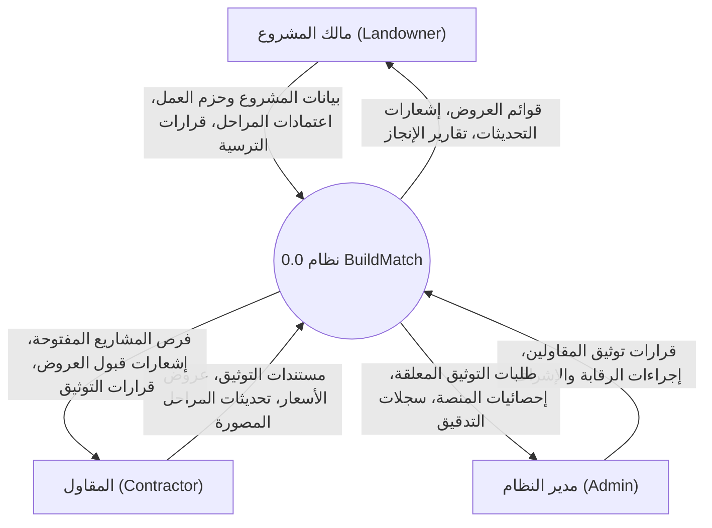

# BuildMatch — مخططات تدفق البيانات (Data Flow Diagrams — DFD Level 0 & 1)

## 1. مخطط تدفق البيانات - المستوى 0 (DFD Level 0 — Context Diagram)

---

## 2. مخطط تدفق البيانات - المستوى 1 (DFD Level 1)

```mermaid
flowchart TD
    Landowner["مالك المشروع"]
    Contractor["المقاول"]
    Admin["مدير النظام"]

    subgraph العمليات_الرئيسية [Processes]
        P1["1.0 إدارة المصادقة والتسجيل"]
        P2["2.0 مراجعة وتوثيق المقاولين"]
        P3["3.0 إدارة المشاريع وحزم العمل"]
        P4["4.0 تقديم ومقارنة العروض"]
        P5["5.0 الترسية الذرية للمقاولين"]
        P6["6.0 إدارة ومتابعة التنفيذ"]
        P7["7.0 الرقابة وسجلات التدقيق"]
    end

    subgraph مخازن_البيانات [Data Stores]
        D1[("D1: المستخدمين والملفات الشخصية")]
        D2[("D2: مستندات التوثيق والباكت")]
        D3[("D3: المشاريع وحزم العمل")]
        D4[("D4: العروض وجداول الكميات")]
        D5[("D5: المراحل وتحديثات التنفيذ")]
        D6[("D6: سجلات التدقيق (Audit Logs)")]
    end

    Landowner -->|بيانات التسجيل| P1
    Contractor -->|بيانات التسجيل| P1
    P1 -->|حفظ الحساب| D1

    Contractor -->|مستندات السجل والبطاقة| P2
    P2 -->|تخزين المستندات| D2
    Admin -->|قرار التوثيق والاعتماد| P2
    P2 -->|تحديث حالة التوثيق| D1
    P2 -->|تسجيل تدقيق| D6

    Landowner -->|نشر المشروع والمخططات| P3
    P3 -->|حفظ المشروع والحزم| D3
    Contractor -->|استكشاف الحزم المفتوحة| P3

    Contractor -->|تقديم عرض سعر مهيكل| P4
    P4 -->|حفظ العروض| D4
    Landowner -->|استعراض مقارنة العروض| P4

    Landowner -->|اختيار العرض الفائز| P5
    P5 -->|قفل وتحديث الحزمة| D3
    P5 -->|قبول العرض ورفض المنافسين| D4
    P5 -->|تسجيل تدقيق الترسية| D6

    Contractor -->|رفع نسب الإنجاز والصور| P6
    P6 -->|تخزين مراحل التنفيذ| D5
    Landowner -->|اعتماد المرحلة أو طلب التعديل| P6

    Admin -->|مراقبة الأنشطة والتقارير| P7
    P7 -->|قراءة السجلات والنشاط| D6
```

