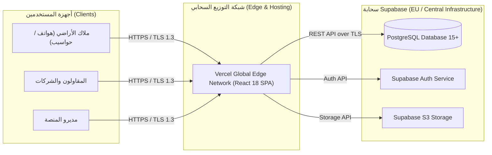

# BuildMatch — البنية الأمنية الشاملة ومخطط النشر (Security Architecture & Deployment)

## 1. البنية الأمنية (Security Architecture)

```mermaid
flowchart TD
    subgraph UntrustedZone ["المنطقة غير الموثوقة (Public Client Zone)"]
        Browser["متصفح المستخدم (Browser)"]
        Token["Supabase JWT (Role Claims)"]
    end

    subgraph DefenseLine ["خط الدفاع الأول (API Gateway & PostgREST)"]
        Gateway["Supabase Kong API Gateway"]
        AuthVerify["فحص وتدقيق صحة التوقيع للـ JWT"]
    end

    subgraph CoreSecurityZone ["منطقة الأمان الجوهرية (Database Engine Enforcement)"]
        RLS_Engine["محرك سياسات الصفوف (Row Level Security)"]
        Definer_RPC["دوال SECURITY DEFINER المخزنة (مع تثبيت search_path)"]
        Triggers["تريجرات المراقبة والتحديث الزمني"]
        AuditLog["سجل العمليات الإدارية الحساسة (audit_logs)"]
    end

    subgraph IsolatedStorage ["عزل المستندات الحساسة (Private Storage Engine)"]
        Storage_Auth["فحص مسار المجلد ومطابقته لـ auth.uid()"]
        PrivateBuckets["باكت مستندات التوثيق والرسومات"]
    end

    Browser -->|طلب عبر HTTPS مع JWT| Gateway
    Gateway --> AuthVerify
    AuthVerify -->|طلب مصرح به| RLS_Engine
    AuthVerify -->|استدعاء معاملة خاصة| Definer_RPC
    Gateway -->|طلب تحميل أو رفع ملف| Storage_Auth

    RLS_Engine -->|فحص شرط auth.uid()| AuditLog
    Definer_RPC -->|تنفيذ آمن مقفل السجلات| AuditLog
    Storage_Auth --> PrivateBuckets
```

### معايير الأمان الإلزامية الخمسة:
1. **منع الترقية الذاتية للصلاحيات (Privilege Escalation):**
   - التحقق من الدور أثناء إنشاء الحساب عبر سياسة `WITH CHECK (role IN ('landowner', 'contractor'))` لحظر إنشاء دور `admin`.
   - قفل حقل `role` في سياسة التحديث `profiles_update_policy` بحيث لا يستطيع المستخدم تعديل دوره.
2. **عزل مستندات المقاولين (Contractor KYC Privacy):**
   - حظر الاستعراض العام لمستندات التوثيق الشخصية؛ لا يراها سوى المقاول نفسه ومديري النظام.
3. **الترسية المقفلة تنافسياً (Concurrency-Safe Selection):**
   - قفل سجل حزمة العمل بواسطة `FOR UPDATE` داخل دالة `select_contractor_for_package` لمنع الترسية المزدوجة.
4. **حظر المفاتيح السرية في الواجهات:**
   - عدم تضمين `service_role` مطلقاً؛ العمل حصراً بمفتاح `anon` وJWT.
5. **سجل تدقيق غير قابل للحذف (Immutable Audit Trail):**
   - منع عمليات INSERT وUPDATE وDELETE المباشرة من العميل على جدول `audit_logs` وحصره على دوال النظام الموثوقة.

---

## 2. مخطط النشر والتوزيع (Deployment Diagram)


