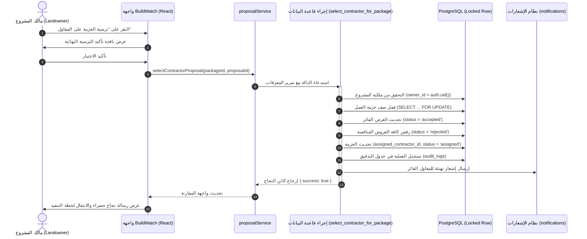
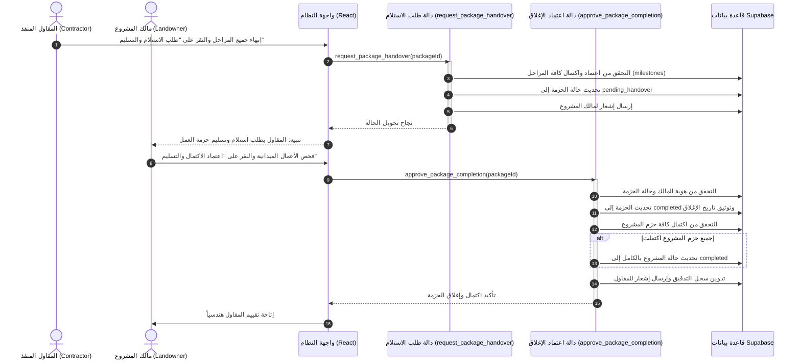

# BuildMatch — المخططات التتابعية (Sequence Diagrams)

## 1. المخطط التتابعي للترسية الذرية (Atomic Contractor Selection Sequence)

---

## 2. المخطط التتابعي للاستلام النهائي للحزمة (Handover & Completion Sequence)

