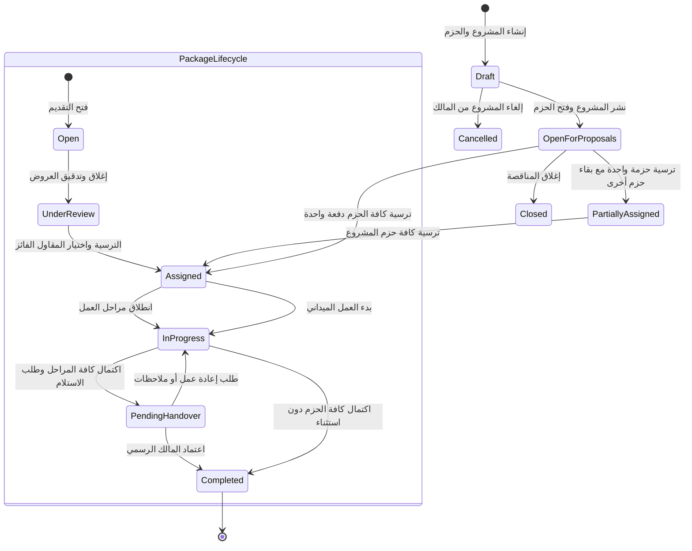
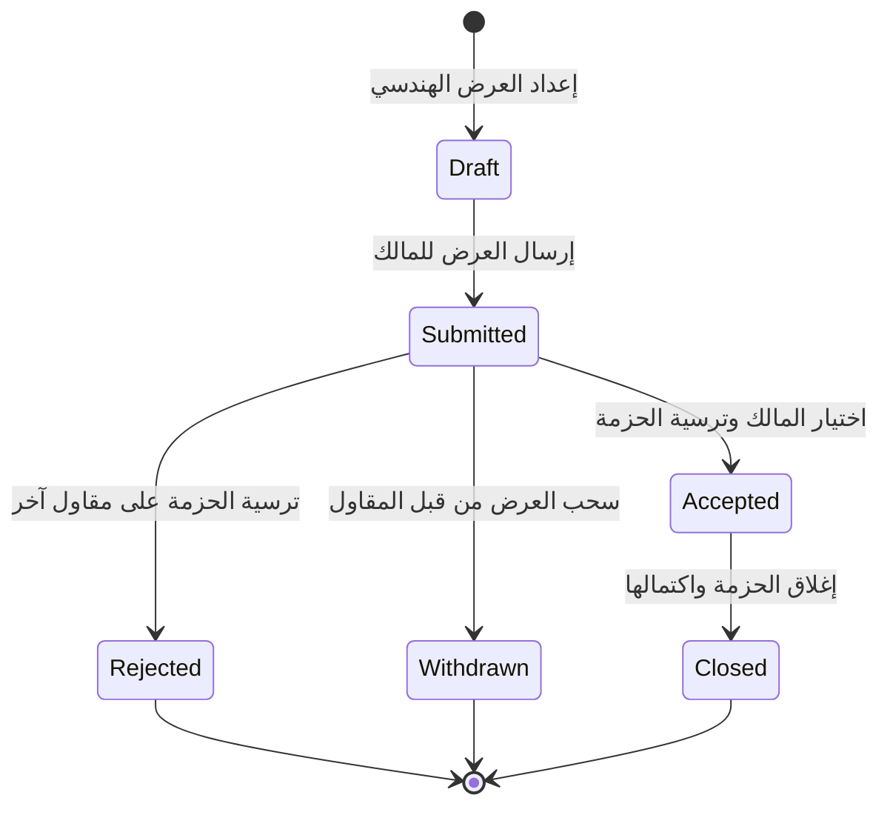
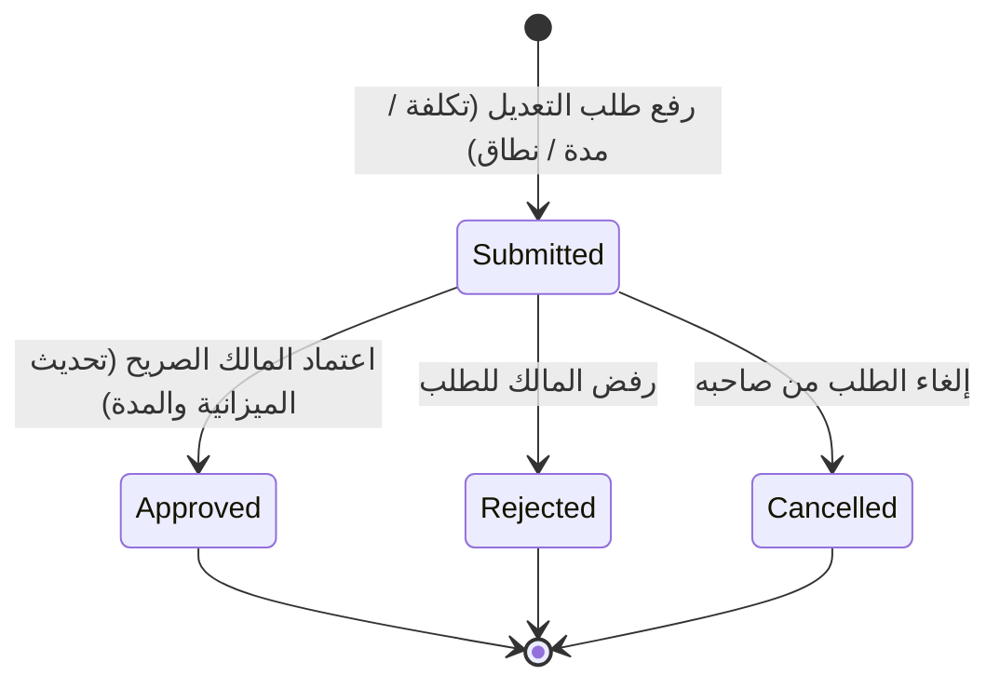

# BuildMatch — مخططات الحالات (State Machine Diagrams)

## 1. مخطط حالات المشروع وحزمة العمل (Project & Package States)

---

## 2. مخطط حالات عروض الأسعار (Proposal State Machine)

---

## 3. مخطط حالات طلبات التعديل (Change Request State Machine)

