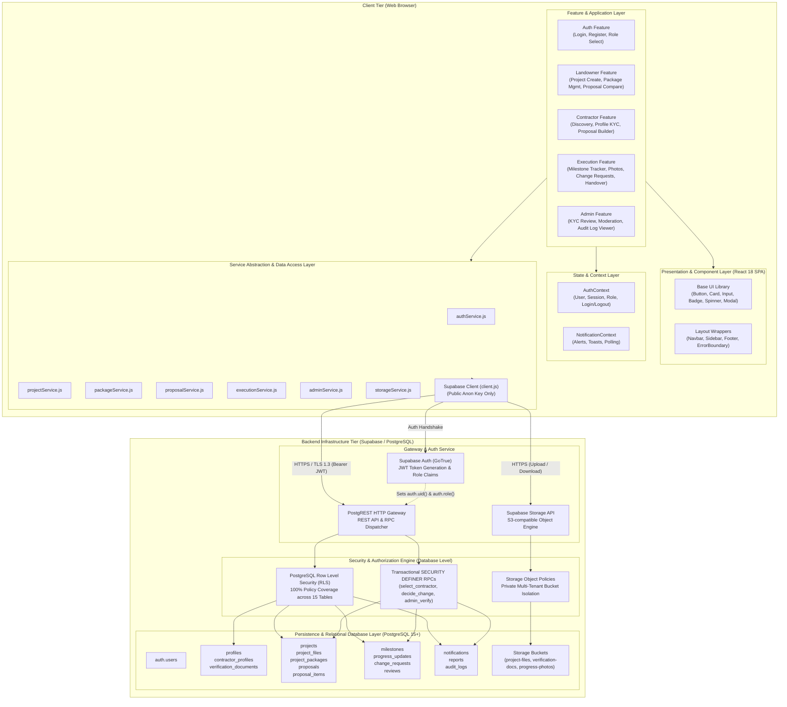

# BuildMatch — System Architecture Specification

| Document Metadata | Value |
| :--- | :--- |
| **Document ID** | BM-SAD-05 |
| **Document Purpose** | Comprehensive architectural design, structural breakdown, layered model, and cross-cutting architectural concerns |
| **System Name** | BuildMatch (بيلد ماتش) |
| **Version** | 1.0.0 |
| **Date** | 2026-11-16 |
| **Status** | Approved & Grounded in Repository Architecture |

---

## 1. Architectural Style & Rationale

BuildMatch adopts a **Modular Monolith** architectural style paired with a **Backend-as-a-Service (BaaS)** operational model powered by PostgreSQL and Supabase.

### 1.1 Architectural Rationale: Why Modular Monolith?
1. **Domain Cohesion:** The marketplace procurement and construction execution workflows represent tightly coupled phases of a single business lifecycle. Splitting them into separate microservices would introduce distributed transaction complexities (e.g., Saga patterns, eventual consistency hazards during contractor selection) without tangible business benefits for an MVP.
2. **Transactional Guarantees:** Critical workflows—specifically proposal selection and milestone sign-offs—require strict ACID guarantees. A unified relational database enables instantaneous row-level locking (`FOR UPDATE OF pkg`) and atomic rollbacks within a single database transaction.
3. **Engineering Velocity & Operational Simplicity:** A single React 18 single-page application (SPA) with feature-based directory encapsulation simplifies deployment, debugging, and testing while maintaining strict modular boundaries.

### 1.2 State Management Rationale: Why React Context Over Redux?
The platform intentionally relies on **React Context API** (`AuthContext`, `NotificationContext`) combined with local component state and dedicated service layers, rather than heavyweight global state libraries such as Redux or MobX.
- The majority of platform state consists of **server-cache data** (project lists, proposals, milestones) fetched on-demand through `src/services/`.
- Client-side global state is strictly confined to user authentication identity, active role, and ephemeral notifications.
- This architectural decision eliminates redundant boilerplate, reduces the client JavaScript bundle size by over 40 KB, and simplifies asynchronous error propagation.

---

## 2. High-Level Architecture Diagram

The system architecture cleanly separates the Client Browser Tier from the Backend Infrastructure Tier.



*(Source file preserved in `diagrams/architecture-diagram.mmd`)*

---

## 3. Layered Architectural Decomposition

### 3.1 Layer 1: Presentation & UI Layer
- **Technology:** React 18, Tailwind CSS, Heroicons / Lucide React icons.
- **Responsibilities:** Renders accessible, responsive visual interfaces; enforces RTL/LTR layout orientation; presents standardized components (`Button`, `Card`, `Input`, `Badge`, `Spinner`, `Modal`, `ErrorBoundary`).
- **Isolation Rule:** UI components never invoke Supabase APIs directly; all remote mutations are mediated through domain services.

### 3.2 Layer 2: Application & Feature Layer
- **Structure:** Located in `src/features/` organized by business domain:
  - `src/features/auth/`: Registration, Login, Protected Route Gates.
  - `src/features/landowner/`: Project authoring, Package breakdown, Proposal comparison matrix.
  - `src/features/contractor/`: Discovery feed, KYC document uploader, Structured BOQ proposal builder.
  - `src/features/execution/`: Milestone progress tracker, Photo evidence uploader, Change Request modal, Handover requests.
  - `src/features/admin/`: Verification review workbench, User moderation, Audit log inspector.
- **Responsibilities:** Orchestrates user workflows, handles form validation (React Hook Form + Zod), manages component-level state transitions, and invokes domain services.

### 3.3 Layer 3: Service Abstraction & Data Access Layer
- **Structure:** Located in `src/services/`:
  - `client.js`: Initializes and exports the shared Supabase client configured with the public anon key.
  - `authService.js`: Wraps Supabase Auth (`signUp`, `signInWithPassword`, `signOut`, `getSession`).
  - `projectService.js`: Project CRUD, file uploads, and status transitions.
  - `packageService.js`: Work package decomposition and discovery queries.
  - `proposalService.js`: Proposal authoring, BOQ line items, and atomic selection RPC execution.
  - `executionService.js`: Milestone logging, progress photos, change requests, handover, and reviews.
  - `adminService.js`: Contractor verification RPC, audit queries, and reports.
  - `storageService.js`: File upload, signed URL generation, and MIME validation.
- **Responsibilities:** Encapsulates PostgREST queries, transforms database payloads, and normalizes error objects before returning to UI components.

### 3.4 Layer 4: Gateway & Security Engine (Backend)
- **Supabase Auth (GoTrue):** Issues cryptographically signed RS256/HS256 JSON Web Tokens (JWTs) containing `sub` (`auth.uid()`) and `role` claims.
- **PostgREST API Engine:** Translates HTTP requests into parameterized SQL queries executed under the security context of the authenticated user.
- **Row Level Security (RLS) Engine:** Enforces row-level isolation on every query before returning rows to the client.
- **Database Functions & RPCs:** Executes atomic multi-row operations under `SECURITY DEFINER` with explicit `search_path = public, auth, pg_temp;`.

### 3.5 Layer 5: Data Persistence & Storage Layer
- **PostgreSQL 15+ Relational Database:** 15 normalized tables, foreign key constraints, check constraints, B-tree/GIN indexes, and updated-at triggers.
- **Supabase Storage Engine:** S3-compatible object storage managing 3 private buckets (`project-files`, `verification-docs`, `progress-photos`) governed by SQL RLS policies on `storage.objects`.

---

## 4. Authentication, Authorization & Route Protection Flow

```
[User Browser]
      |
      | 1. Submit Credentials (email + password)
      v
[authService.login()]
      |
      | 2. supabase.auth.signInWithPassword()
      v
[Supabase Auth (GoTrue)] ---- (Validates against auth.users)
      |
      | 3. Returns Session JWT (claims: sub=UUID, role=authenticated)
      v
[AuthContext.jsx]
      |
      | 4. Fetch User Profile (SELECT role FROM public.profiles WHERE id = auth.uid())
      | 5. Store session in memory & set user.role ('landowner' | 'contractor' | 'admin')
      v
[AppRoutes.jsx / ProtectedRoute]
      |
      |-- If route role matches user.role --> Render Feature Page Component
      |-- If unauthenticated              --> Redirect to /login
      `-- If role mismatch                --> Redirect to /unauthorized (403)
```

---

## 5. Cross-Cutting Architectural Concerns

### 5.1 Error Handling & Resilience
- **UI Level:** `ErrorBoundary.jsx` catches unexpected React rendering errors, displaying a recovery UI without crashing the entire SPA.
- **Network Level:** Domain services catch Supabase network or API errors, transforming raw PostgreSQL error codes (e.g., `23505` unique violation, `P0001` raise exception) into user-friendly localized messages.
- **Form Level:** Zod schemas validate user inputs prior to network transmission, catching format errors immediately.

### 5.2 Storage & File Upload Strategy
- **Path Isolation Convention:**
  - `project-files`: `{project_id}/{file_name}`
  - `verification-docs`: `{contractor_id}/{file_name}`
  - `progress-photos`: `{package_id}/{milestone_id}/{file_name}`
- **Security Guardrails:** Storage policies in migration 04 evaluate the path prefix against relational database tables (`projects`, `contractor_profiles`, `milestones`) to ensure users can only upload files to their authorized folders.
- **File Limits:**
  - `project-files`: 25 MiB (PDF, PNG, JPG, DWG).
  - `verification-docs`: 10 MiB (PDF, PNG, JPG).
  - `progress-photos`: 15 MiB (PNG, JPG, WEBP).

### 5.3 Concurrency & Atomic Operations
- Sensitive multi-row operations never execute as sequential client-side queries.
- They are mediated through `SECURITY DEFINER` stored procedures executing inside atomic PostgreSQL transactions:
  - `select_contractor_for_package`: Employs `FOR UPDATE OF pkg` row locking to eliminate race conditions between competing selection requests.
  - `decide_change_request`: Updates request status, logs decision, and updates audit records in one transaction.
  - `admin_verify_contractor`: Updates status, sets verification metadata, and creates audit log entry.
