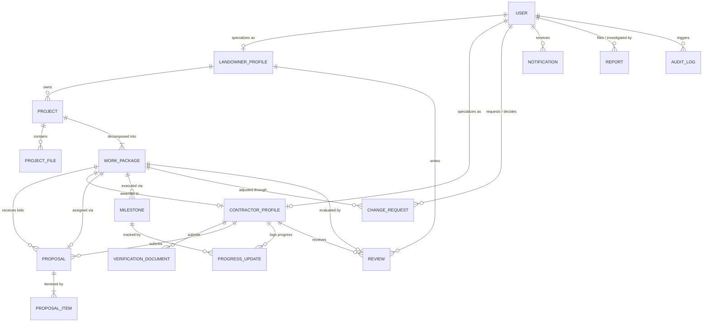
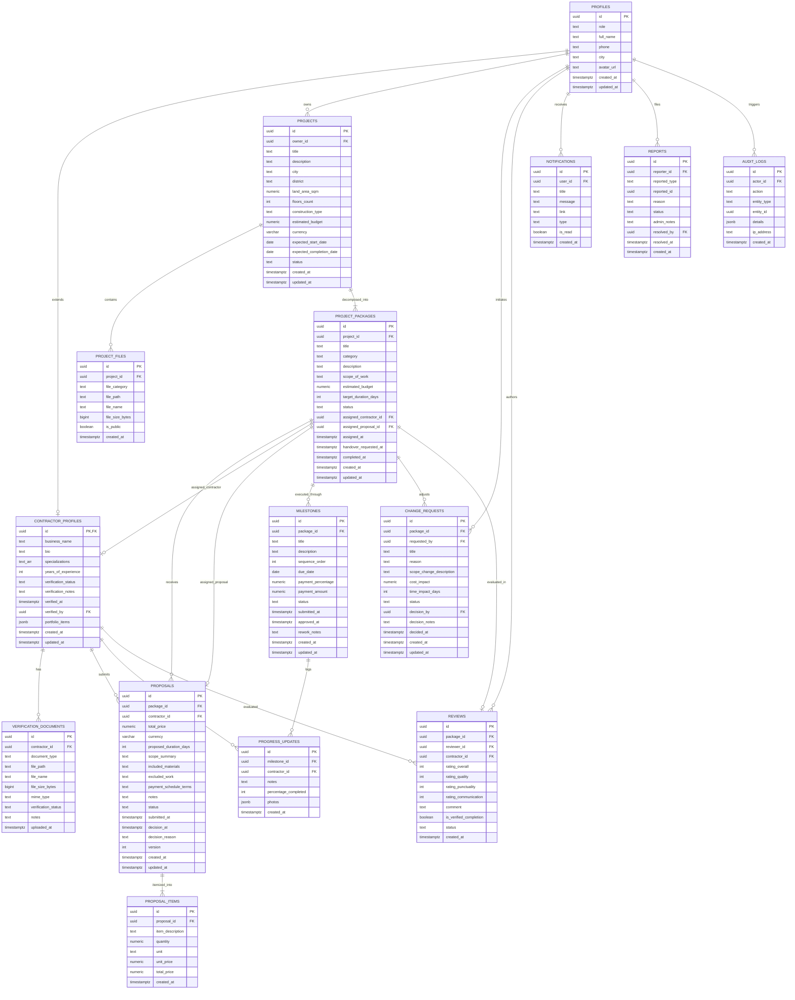

# BuildMatch — Database Design & Data Modeling Specification

| Document Metadata | Value |
| :--- | :--- |
| **Document ID** | BM-SAD-06 |
| **Document Purpose** | Comprehensive relational database design, data dictionary, physical schema mapping, RLS matrix, and referential integrity rules |
| **System Name** | BuildMatch (بيلد ماتش) |
| **Database Engine** | PostgreSQL 15+ (Local test baseline: PostgreSQL 18.6) |
| **Target Cloud Platform** | Supabase Managed PostgreSQL |
| **Version** | 1.0.0 |
| **Date** | 2026-11-16 |
| **Status** | Implemented & Verified in Migrations 01 - 04 |

---

## 1. Database Architecture Overview

The BuildMatch database is built on a normalized relational architecture engineered to support complex, multi-party construction transactions with strict ACID guarantees.

Key architectural characteristics:
- **UUID Primary Keys:** All tables utilize globally unique identifiers (`gen_random_uuid()` or `uuid-ossp`) to prevent sequential enumeration attacks and facilitate safe client-side ID handling.
- **Relational Integrity:** Explicit foreign keys, check constraints, and unique indexes guarantee data consistency at the engine level.
- **Automated Timestamp Triggers:** The `public.handle_updated_at()` trigger function automatically updates `updated_at` timestamps on all mutable entities before update.
- **100% Row Level Security:** Every table in the `public` schema has RLS enabled, governed by explicit SQL security policies.
- **Transactional Stored Procedures:** Sensitive state transitions (selection, change approvals, verification) are encapsulated in `SECURITY DEFINER` RPCs with immutable search paths.

---

## 2. Conceptual Data Model (ERD)

The conceptual data model captures the essential domain entities and their business relationships:



*(Source file preserved in `diagrams/erd-conceptual.mmd`)*

---

## 3. Physical Database Schema & Data Dictionary

The physical schema consists of exactly **15 normalized tables** in the `public` schema, matching migrations `20261116000001` through `20261116000004` exactly.



*(Source file preserved in `diagrams/erd-physical.mmd`)*

---

### 3.1 Table: `public.profiles`
Base user profile extending Supabase `auth.users`.
- **Primary Key:** `id` (UUID) references `auth.users(id)` ON DELETE CASCADE.
- **Columns:**
  - `role`: TEXT NOT NULL CHECK (`role IN ('landowner', 'contractor', 'admin')`).
  - `full_name`: TEXT NOT NULL.
  - `phone`: TEXT (Confidential PII).
  - `city`: TEXT NOT NULL DEFAULT `'Cairo'`.
  - `avatar_url`: TEXT NULL.
  - `created_at`: TIMESTAMPTZ NOT NULL DEFAULT NOW().
  - `updated_at`: TIMESTAMPTZ NOT NULL DEFAULT NOW().
- **Triggers:** `tr_profiles_updated_at` BEFORE UPDATE calls `handle_updated_at()`.
- **Indexes:** `idx_profiles_role`, `idx_profiles_city`.
- **Sensitive Classification:** Confidential (PII: Phone, Full Name).

### 3.2 Table: `public.contractor_profiles`
Commercial contractor company and licensing metadata.
- **Primary Key:** `id` (UUID) references `public.profiles(id)` ON DELETE CASCADE.
- **Columns:**
  - `business_name`: TEXT NOT NULL.
  - `bio`: TEXT NULL.
  - `specializations`: TEXT[] NOT NULL DEFAULT `'{}'`.
  - `years_of_experience`: INTEGER NOT NULL DEFAULT 0 CHECK (`years_of_experience >= 0`).
  - `verification_status`: TEXT NOT NULL DEFAULT `'pending'` CHECK (`verification_status IN ('pending', 'approved', 'rejected')`).
  - `verification_notes`: TEXT NULL (Confidential Admin Notes).
  - `verified_at`: TIMESTAMPTZ NULL.
  - `verified_by`: UUID NULL REFERENCES `public.profiles(id)` ON DELETE SET NULL.
  - `portfolio_items`: JSONB NOT NULL DEFAULT `'[]'::jsonb`.
  - `created_at`, `updated_at`: TIMESTAMPTZ NOT NULL DEFAULT NOW().
- **Triggers:** `tr_contractor_profiles_updated_at`.
- **Indexes:** `idx_contractor_verification_status`, `idx_contractor_specializations` (GIN).

### 3.3 Table: `public.verification_documents`
Contractor KYC files (Commercial Register, Tax Card, Syndicate ID).
- **Primary Key:** `id` (UUID) DEFAULT `gen_random_uuid()`.
- **Foreign Keys:** `contractor_id` (UUID) REFERENCES `public.contractor_profiles(id)` ON DELETE CASCADE.
- **Columns:**
  - `document_type`: TEXT NOT NULL CHECK (`document_type IN ('commercial_register', 'tax_card', 'syndicate_id', 'id_card', 'insurance_certificate', 'other')`).
  - `file_path`: TEXT NOT NULL.
  - `file_name`: TEXT NOT NULL.
  - `file_size_bytes`: BIGINT NULL.
  - `mime_type`: TEXT NULL.
  - `verification_status`: TEXT NOT NULL DEFAULT `'pending'` CHECK (`verification_status IN ('pending', 'approved', 'rejected')`).
  - `notes`: TEXT NULL.
  - `uploaded_at`: TIMESTAMPTZ NOT NULL DEFAULT NOW().
- **Indexes:** `idx_verification_docs_contractor`, `idx_verification_docs_status`.
- **Sensitive Classification:** Highly Restricted (Private Legal Documents).

### 3.4 Table: `public.projects`
Residential construction projects created by landowners.
- **Primary Key:** `id` (UUID) DEFAULT `gen_random_uuid()`.
- **Foreign Keys:** `owner_id` (UUID) REFERENCES `public.profiles(id)` ON DELETE CASCADE.
- **Columns:**
  - `title`: TEXT NOT NULL.
  - `description`: TEXT NOT NULL.
  - `city`: TEXT NOT NULL.
  - `district`: TEXT NULL.
  - `land_area_sqm`: NUMERIC(10, 2) NOT NULL CHECK (`land_area_sqm > 0`).
  - `floors_count`: INTEGER NOT NULL DEFAULT 1 CHECK (`floors_count >= 1`).
  - `construction_type`: TEXT NOT NULL CHECK (`construction_type IN ('concrete_skeleton', 'full_turnkey', 'finishing_only', 'renovation', 'structural_extension')`).
  - `estimated_budget`: NUMERIC(14, 2) NULL CHECK (`estimated_budget IS NULL OR estimated_budget > 0`).
  - `currency`: VARCHAR(3) NOT NULL DEFAULT `'EGP'`.
  - `expected_start_date`: DATE NULL.
  - `expected_completion_date`: DATE NULL.
  - `status`: TEXT NOT NULL DEFAULT `'draft'` CHECK (`status IN ('draft', 'open_for_proposals', 'under_review', 'partially_assigned', 'assigned', 'in_progress', 'completed', 'cancelled', 'closed')`).
  - `created_at`, `updated_at`: TIMESTAMPTZ NOT NULL DEFAULT NOW().
- **Constraints:** `chk_projects_dates` CHECK (`expected_completion_date IS NULL OR expected_start_date IS NULL OR expected_completion_date >= expected_start_date`).
- **Triggers:** `tr_projects_updated_at`.
- **Indexes:** `idx_projects_owner`, `idx_projects_status`, `idx_projects_city`.

### 3.5 Table: `public.project_files`
Architectural blueprints, CAD drawings, soil reports, permits.
- **Primary Key:** `id` (UUID) DEFAULT `gen_random_uuid()`.
- **Foreign Keys:** `project_id` (UUID) REFERENCES `public.projects(id)` ON DELETE CASCADE.
- **Columns:**
  - `file_category`: TEXT NOT NULL CHECK (`file_category IN ('architectural_drawing', 'structural_drawing', 'site_photo', 'soil_report', 'license_permit', 'other')`).
  - `file_path`: TEXT NOT NULL.
  - `file_name`: TEXT NOT NULL.
  - `file_size_bytes`: BIGINT NULL.
  - `is_public`: BOOLEAN NOT NULL DEFAULT FALSE.
  - `created_at`: TIMESTAMPTZ NOT NULL DEFAULT NOW().
- **Indexes:** `idx_project_files_project`.

### 3.6 Table: `public.project_packages`
Modular work packages decomposing projects into trades.
- **Primary Key:** `id` (UUID) DEFAULT `gen_random_uuid()`.
- **Foreign Keys:**
  - `project_id` (UUID) REFERENCES `public.projects(id)` ON DELETE CASCADE.
  - `assigned_contractor_id` (UUID) REFERENCES `public.contractor_profiles(id)` ON DELETE SET NULL.
  - `assigned_proposal_id` (UUID) REFERENCES `public.proposals(id)` ON DELETE SET NULL.
- **Columns:**
  - `title`: TEXT NOT NULL.
  - `category`: TEXT NOT NULL CHECK (`category IN ('excavation_foundation', 'concrete_skeleton', 'masonry', 'plumbing_sanitary', 'electrical', 'hvac', 'insulation', 'plaster_gypsum', 'flooring_tiling', 'painting', 'carpentry_aluminum', 'facades', 'turnkey')`).
  - `description`: TEXT NOT NULL.
  - `scope_of_work`: TEXT NOT NULL.
  - `estimated_budget`: NUMERIC(14, 2) NULL CHECK (`estimated_budget IS NULL OR estimated_budget > 0`).
  - `target_duration_days`: INTEGER NULL CHECK (`target_duration_days IS NULL OR target_duration_days > 0`).
  - `status`: TEXT NOT NULL DEFAULT `'draft'` CHECK (`status IN ('draft', 'open', 'under_review', 'assigned', 'in_progress', 'pending_handover', 'completed', 'cancelled', 'closed')`).
  - `assigned_at`, `handover_requested_at`, `completed_at`: TIMESTAMPTZ NULL.
  - `created_at`, `updated_at`: TIMESTAMPTZ NOT NULL DEFAULT NOW().
- **Triggers:** `tr_project_packages_updated_at`.
- **Indexes:** `idx_packages_project`, `idx_packages_status`, `idx_packages_category`, `idx_packages_contractor`.

### 3.7 Table: `public.proposals`
Contractor structured bids.
- **Primary Key:** `id` (UUID) DEFAULT `gen_random_uuid()`.
- **Foreign Keys:**
  - `package_id` (UUID) REFERENCES `public.project_packages(id)` ON DELETE CASCADE.
  - `contractor_id` (UUID) REFERENCES `public.contractor_profiles(id)` ON DELETE CASCADE.
- **Columns:**
  - `total_price`: NUMERIC(14, 2) NOT NULL CHECK (`total_price > 0`).
  - `currency`: VARCHAR(3) NOT NULL DEFAULT `'EGP'`.
  - `proposed_duration_days`: INTEGER NOT NULL CHECK (`proposed_duration_days > 0`).
  - `scope_summary`: TEXT NOT NULL.
  - `included_materials`: TEXT NULL.
  - `excluded_work`: TEXT NULL.
  - `payment_schedule_terms`: TEXT NOT NULL.
  - `notes`: TEXT NULL.
  - `status`: TEXT NOT NULL DEFAULT `'draft'` CHECK (`status IN ('draft', 'submitted', 'accepted', 'rejected', 'withdrawn', 'closed')`).
  - `submitted_at`, `decision_at`: TIMESTAMPTZ NULL.
  - `decision_reason`: TEXT NULL.
  - `version`: INTEGER NOT NULL DEFAULT 1.
  - `created_at`, `updated_at`: TIMESTAMPTZ NOT NULL DEFAULT NOW().
- **Unique Partial Index:** `uq_contractor_active_proposal_per_package` ON `(package_id, contractor_id)` WHERE `status IN ('draft', 'submitted', 'accepted')`.
- **Triggers:** `tr_proposals_updated_at`.
- **Indexes:** `idx_proposals_package`, `idx_proposals_contractor`, `idx_proposals_status`.

### 3.8 Table: `public.proposal_items`
Itemized Bill of Quantities (BOQ).
- **Primary Key:** `id` (UUID) DEFAULT `gen_random_uuid()`.
- **Foreign Keys:** `proposal_id` (UUID) REFERENCES `public.proposals(id)` ON DELETE CASCADE.
- **Columns:**
  - `item_description`: TEXT NOT NULL.
  - `quantity`: NUMERIC(10, 2) NOT NULL DEFAULT 1 CHECK (`quantity > 0`).
  - `unit`: TEXT NOT NULL DEFAULT `'item'`.
  - `unit_price`: NUMERIC(14, 2) NOT NULL CHECK (`unit_price >= 0`).
  - `total_price`: NUMERIC(14, 2) NOT NULL CHECK (`total_price >= 0`).
  - `created_at`: TIMESTAMPTZ NOT NULL DEFAULT NOW().
- **Indexes:** `idx_proposal_items_proposal`.

### 3.9 Table: `public.milestones`
Sequential execution deliverables.
- **Primary Key:** `id` (UUID) DEFAULT `gen_random_uuid()`.
- **Foreign Keys:** `package_id` (UUID) REFERENCES `public.project_packages(id)` ON DELETE CASCADE.
- **Columns:**
  - `title`: TEXT NOT NULL.
  - `description`: TEXT NOT NULL.
  - `sequence_order`: INTEGER NOT NULL CHECK (`sequence_order >= 1`).
  - `due_date`: DATE NULL.
  - `payment_percentage`: NUMERIC(5, 2) NOT NULL DEFAULT 0 CHECK (`payment_percentage >= 0 AND payment_percentage <= 100`).
  - `payment_amount`: NUMERIC(14, 2) NULL CHECK (`payment_amount IS NULL OR payment_amount >= 0`).
  - `status`: TEXT NOT NULL DEFAULT `'pending'` CHECK (`status IN ('pending', 'in_progress', 'submitted_for_review', 'approved', 'rework_required')`).
  - `submitted_at`, `approved_at`: TIMESTAMPTZ NULL.
  - `rework_notes`: TEXT NULL.
  - `created_at`, `updated_at`: TIMESTAMPTZ NOT NULL DEFAULT NOW().
- **Constraints:** `uq_milestone_sequence` UNIQUE `(package_id, sequence_order)`.
- **Triggers:** `tr_milestones_updated_at`.
- **Indexes:** `idx_milestones_package`, `idx_milestones_status`.

### 3.10 Table: `public.progress_updates`
Milestone logs with photographic evidence.
- **Primary Key:** `id` (UUID) DEFAULT `gen_random_uuid()`.
- **Foreign Keys:**
  - `milestone_id` (UUID) REFERENCES `public.milestones(id)` ON DELETE CASCADE.
  - `contractor_id` (UUID) REFERENCES `public.contractor_profiles(id)` ON DELETE CASCADE.
- **Columns:**
  - `notes`: TEXT NOT NULL.
  - `percentage_completed`: INTEGER NOT NULL CHECK (`percentage_completed >= 0 AND percentage_completed <= 100`).
  - `photos`: JSONB NOT NULL DEFAULT `'[]'::jsonb`.
  - `created_at`: TIMESTAMPTZ NOT NULL DEFAULT NOW().
- **Indexes:** `idx_progress_updates_milestone`.

### 3.11 Table: `public.change_requests`
Formal scope, cost, or duration adjustment requests.
- **Primary Key:** `id` (UUID) DEFAULT `gen_random_uuid()`.
- **Foreign Keys:**
  - `package_id` (UUID) REFERENCES `public.project_packages(id)` ON DELETE CASCADE.
  - `requested_by` (UUID) REFERENCES `public.profiles(id)` ON DELETE CASCADE.
  - `decision_by` (UUID) REFERENCES `public.profiles(id)` ON DELETE SET NULL.
- **Columns:**
  - `title`: TEXT NOT NULL.
  - `reason`: TEXT NOT NULL.
  - `scope_change_description`: TEXT NOT NULL.
  - `cost_impact`: NUMERIC(14, 2) NOT NULL DEFAULT 0.
  - `time_impact_days`: INTEGER NOT NULL DEFAULT 0.
  - `status`: TEXT NOT NULL DEFAULT `'submitted'` CHECK (`status IN ('draft', 'submitted', 'approved', 'rejected', 'cancelled')`).
  - `decision_notes`: TEXT NULL.
  - `decided_at`: TIMESTAMPTZ NULL.
  - `created_at`, `updated_at`: TIMESTAMPTZ NOT NULL DEFAULT NOW().
- **Triggers:** `tr_change_requests_updated_at`.
- **Indexes:** `idx_change_requests_package`, `idx_change_requests_status`.

### 3.12 Table: `public.reviews`
Post-completion contractor performance ratings.
- **Primary Key:** `id` (UUID) DEFAULT `gen_random_uuid()`.
- **Foreign Keys:**
  - `package_id` (UUID) REFERENCES `public.project_packages(id)` ON DELETE CASCADE.
  - `reviewer_id` (UUID) REFERENCES `public.profiles(id)` ON DELETE CASCADE.
  - `contractor_id` (UUID) REFERENCES `public.contractor_profiles(id)` ON DELETE CASCADE.
- **Columns:**
  - `rating_overall`: INTEGER NOT NULL CHECK (`rating_overall BETWEEN 1 AND 5`).
  - `rating_quality`: INTEGER NULL CHECK (`rating_quality BETWEEN 1 AND 5`).
  - `rating_punctuality`: INTEGER NULL CHECK (`rating_punctuality BETWEEN 1 AND 5`).
  - `rating_communication`: INTEGER NULL CHECK (`rating_communication BETWEEN 1 AND 5`).
  - `comment`: TEXT NOT NULL.
  - `is_verified_completion`: BOOLEAN NOT NULL DEFAULT TRUE.
  - `status`: TEXT NOT NULL DEFAULT `'published'` CHECK (`status IN ('published', 'hidden', 'flagged')`).
  - `created_at`: TIMESTAMPTZ NOT NULL DEFAULT NOW().
- **Constraints:** `uq_review_per_package` UNIQUE `(package_id, reviewer_id)`.
- **Indexes:** `idx_reviews_contractor`.

### 3.13 Table: `public.notifications`
In-app user event notifications.
- **Primary Key:** `id` (UUID) DEFAULT `gen_random_uuid()`.
- **Foreign Keys:** `user_id` (UUID) REFERENCES `public.profiles(id)` ON DELETE CASCADE.
- **Columns:**
  - `title`: TEXT NOT NULL.
  - `message`: TEXT NOT NULL.
  - `link`: TEXT NULL.
  - `type`: TEXT NOT NULL DEFAULT `'system'`.
  - `is_read`: BOOLEAN NOT NULL DEFAULT FALSE.
  - `created_at`: TIMESTAMPTZ NOT NULL DEFAULT NOW().
- **Indexes:** `idx_notifications_user_unread` ON `(user_id, is_read)`.

### 3.14 Table: `public.reports`
Dispute and moderation records.
- **Primary Key:** `id` (UUID) DEFAULT `gen_random_uuid()`.
- **Foreign Keys:**
  - `reporter_id` (UUID) REFERENCES `public.profiles(id)` ON DELETE CASCADE.
  - `resolved_by` (UUID) REFERENCES `public.profiles(id)` ON DELETE SET NULL.
- **Columns:**
  - `reported_type`: TEXT NOT NULL CHECK (`reported_type IN ('project', 'contractor', 'proposal', 'review', 'user')`).
  - `reported_id`: UUID NOT NULL.
  - `reason`: TEXT NOT NULL.
  - `status`: TEXT NOT NULL DEFAULT `'pending'` CHECK (`status IN ('pending', 'investigating', 'resolved', 'dismissed')`).
  - `admin_notes`: TEXT NULL.
  - `resolved_at`: TIMESTAMPTZ NULL.
  - `created_at`: TIMESTAMPTZ NOT NULL DEFAULT NOW().
- **Indexes:** `idx_reports_status`.

### 3.15 Table: `public.audit_logs`
Immutable operational audit trail.
- **Primary Key:** `id` (UUID) DEFAULT `gen_random_uuid()`.
- **Foreign Keys:** `actor_id` (UUID) REFERENCES `public.profiles(id)` ON DELETE SET NULL.
- **Columns:**
  - `action`: TEXT NOT NULL.
  - `entity_type`: TEXT NOT NULL.
  - `entity_id`: UUID NOT NULL.
  - `details`: JSONB NOT NULL DEFAULT `'{}'::jsonb`.
  - `ip_address`: TEXT NULL.
  - `created_at`: TIMESTAMPTZ NOT NULL DEFAULT NOW().
- **Indexes:** `idx_audit_logs_entity`, `idx_audit_logs_actor`, `idx_audit_logs_created_at`.
- **Security Rule:** Append-only via RPCs; client INSERT/UPDATE/DELETE strictly denied.

---

## 4. Normalization Analysis (3NF Compliance)

Every table in the BuildMatch schema complies with **Third Normal Form (3NF)**:
1. **First Normal Form (1NF):** All attributes contain atomic scalar values (or normalized JSON arrays for photo URLs and portfolio showcases). Each table has a defined primary key.
2. **Second Normal Form (2NF):** All tables have single-column primary keys (UUIDs). Therefore, no partial functional dependencies exist.
3. **Third Normal Form (3NF):** No transitive functional dependencies exist:
   - Contractor commercial metadata is segregated into `contractor_profiles` rather than stored in `profiles`.
   - Itemized proposal lines reside in `proposal_items` rather than denormalized arrays within `proposals`.
   - Work packages represent independent entity rows linked to parent projects, allowing multi-contractor assignment without repeating project data.

---

## 5. Row Level Security (RLS) Access Matrix

The following matrix documents the exact permissions enforced across all 15 tables in migration `20261116000002_rls_policies.sql`:

```
+-----------------------------------------------------------------------------------------------+
|                             ROW LEVEL SECURITY (RLS) ACCESS MATRIX                            |
+------------------------+-------------+---------------------+-------------------+--------------+
| TABLE NAME             | GUEST (anon)| LANDOWNER           | CONTRACTOR        | ADMIN        |
+------------------------+-------------+---------------------+-------------------+--------------+
| profiles               | Denied      | Own profile + part. | Own profile + part| Full CRUD    |
| contractor_profiles    | Denied*     | Approved Directory  | Own profile       | Full CRUD    |
| verification_documents | Denied      | Denied              | Own documents     | Full CRUD    |
| projects               | Denied      | Own projects (CRUD) | Open/Published (R)| Full CRUD    |
| project_files          | Denied      | Own project files   | Public / Assigned | Full CRUD    |
| project_packages       | Denied      | Own packages (CRUD) | Open (R) / Assign.| Full CRUD    |
| proposals              | Denied      | Submitted on own pkg| Own proposals     | Full CRUD    |
| proposal_items         | Denied      | Via Proposal policy | Own proposal items| Full CRUD    |
| milestones             | Denied      | Own package (CRUD)  | Assigned pkg (R/U)| Full CRUD    |
| progress_updates       | Denied      | Assigned package (R)| Assigned pkg (C/R)| Full CRUD    |
| change_requests        | Denied      | Own package (CRUD)  | Assigned pkg (C/U)| Full CRUD    |
| reviews                | Denied      | Post-completion (C) | Assigned pkg (R)  | Full CRUD    |
| notifications          | Denied      | Own notifications   | Own notifications | Full CRUD    |
| reports                | Denied      | Insert own (C)      | Insert own (C)    | Full CRUD    |
| audit_logs             | Denied      | Denied              | Denied            | Read-Only    |
+------------------------+-------------+---------------------+-------------------+--------------+
```

*\*Note: Anonymous guests access approved contractor profiles safely via the `contractor_public_directory` view and `get_public_contractor_profile` RPC, which strip private phone numbers and admin notes.*
