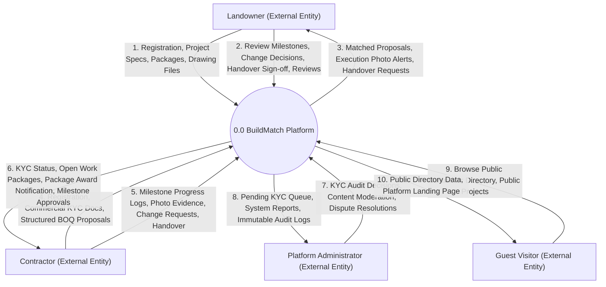
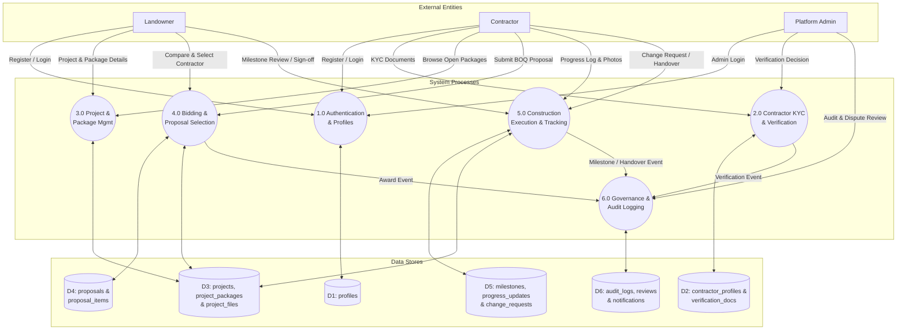
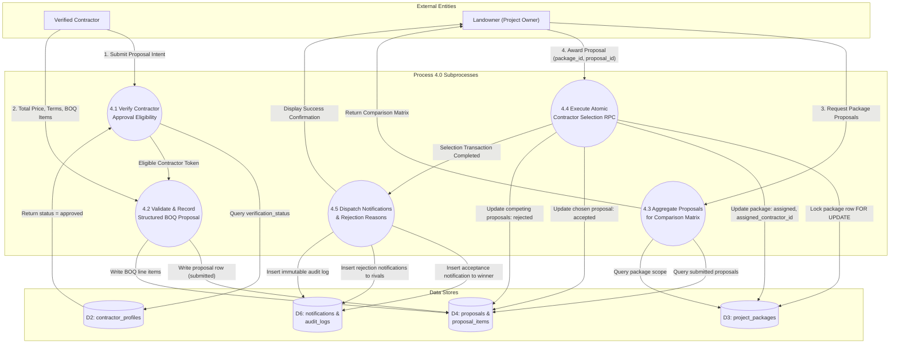
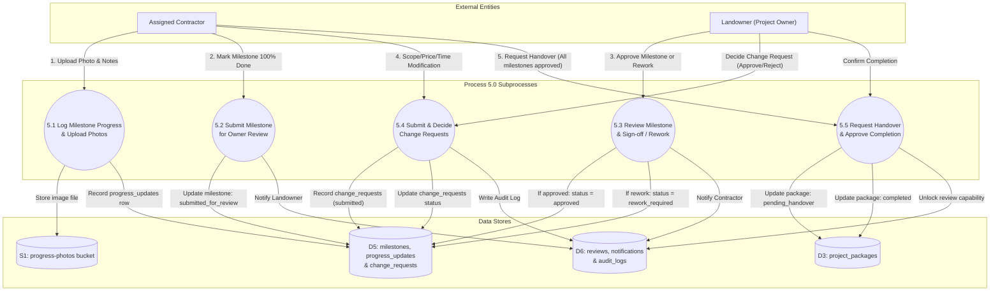

# BuildMatch — Data Flow Diagrams (DFD)

| Document Metadata | Value |
| :--- | :--- |
| **Document ID** | BM-SAD-07 |
| **Document Purpose** | Comprehensive functional decomposition of system data flows across Context (Level-0), Level-0 Decomposition, and Level-1 Detail Workflows |
| **System Name** | BuildMatch (بيلد ماتش) |
| **Version** | 1.0.0 |
| **Date** | 2026-11-16 |
| **Status** | Approved & Grounded in System Workflows |

---

## 1. DFD Modeling Methodology

Data Flow Diagrams (DFDs) model the flow of data through the BuildMatch ecosystem, illustrating how external entities interact with system processes, and how data is transformed, validated, and persisted across relational stores.

### Notation Standard: Gane & Sarson / Yourdon
- **External Entities (Square Nodes):** Landowner, Contractor, Platform Administrator, Guest.
- **Processes (Circles / Rounded Rectangles):** Transformations of data (e.g., 4.4 Execute Atomic Contractor Selection RPC).
- **Data Stores (Open Rectangles / Database Cylinders):** Relational tables and object storage buckets.
- **Data Flows (Directed Arrows):** Packets of structured information moving between entities, processes, and stores.

---

## 2. Context Diagram (Level 0)

The Context Diagram defines the outermost system boundary of BuildMatch, depicting primary data flows entering and leaving the platform from external user roles.

*(Source file preserved in `diagrams/dfd-context.mmd`)*

---

## 3. DFD Level 0 (System Functional Decomposition)

The Level 0 DFD decomposes the BuildMatch platform into six primary operational subsystems interacting with dedicated database stores:

*(Source file preserved in `diagrams/dfd-level-0.mmd`)*

---

## 4. DFD Level 1: Proposal Submission & Atomic Selection (Process 4.0)

This Level 1 diagram models the critical procurement pipeline: contractor verification validation, BOQ submission, landowner comparison aggregation, and concurrency-safe selection RPC execution.

*(Source file preserved in `diagrams/dfd-level-1-proposals.mmd`)*

---

## 5. DFD Level 1: Construction Execution & Handover (Process 5.0)

This Level 1 diagram models execution tracking, photographic evidence verification, Change Requests, and final completion handover.

*(Source file preserved in `diagrams/dfd-level-1-execution.mmd`)*

---

## 6. Data Dictionary of Flow Packets

| Flow Identifier | Flow Name | Source | Destination | Key Attributes / Payload |
| :--- | :--- | :--- | :--- | :--- |
| **DF-01** | `UserRegistrationCredentials` | Guest | 1.0 Auth | `email`, `password`, `full_name`, `phone`, `city`, `role ('landowner'\|'contractor')` |
| **DF-02** | `ContractorKYCPackage` | Contractor | 2.0 KYC | `commercial_register`, `tax_card`, `syndicate_id`, `file_bytes`, `mime_type` |
| **DF-03** | `ProjectPackagePayload` | Landowner | 3.0 Project | `title`, `city`, `land_area_sqm`, `floors_count`, `category`, `scope_of_work`, `budget_egp` |
| **DF-04** | `StructuredProposalBid` | Contractor | 4.0 Bidding | `package_id`, `total_price`, `proposed_duration_days`, `payment_terms`, `items: [{desc, qty, unit, unit_price}]` |
| **DF-05** | `AwardSelectionCommand` | Landowner | 4.0 Bidding | `p_package_id`, `p_proposal_id` (Dispatched to `select_contractor_for_package` RPC) |
| **DF-06** | `ProgressPhotoEvidence` | Contractor | 5.0 Execution| `milestone_id`, `percentage_completed (0-100)`, `notes`, `photo_urls: []` |
| **DF-07** | `ChangeRequestPayload` | Contractor / Owner | 5.0 Execution| `package_id`, `title`, `reason`, `scope_change`, `cost_impact_egp`, `time_impact_days` |
| **DF-08** | `HandoverSignoffCommand` | Landowner | 5.0 Execution| `p_package_id` (Dispatched to `approve_package_completion` RPC) |
| **DF-09** | `VerifiedReviewPayload` | Landowner | 6.0 Governance| `package_id`, `rating_overall (1-5)`, `ratings: {quality, punctuality, comm}`, `comment` |
