# BuildMatch — Use Case Model & Specification

| Document Metadata | Value |
| :--- | :--- |
| **Document ID** | BM-SAD-08 |
| **Document Purpose** | Comprehensive use case model, actor profiles, use case diagrams, and detailed specifications for all major system use cases |
| **System Name** | BuildMatch (بيلد ماتش) |
| **Version** | 1.0.0 |
| **Date** | 2026-11-16 |
| **Status** | Approved & Grounded in System Workflows |

---

## 1. Actor Catalog & Profiles

| Actor Name | Type | Description & System Permissions |
| :--- | :--- | :--- |
| **Guest** | Human (Unauthenticated) | A public visitor exploring the landing page, searching the approved contractor public directory, and viewing published projects. Cannot access private profile data, bids, or execution records. |
| **Landowner** | Human (Authenticated) | A private citizen owning residential land. Authorized to create projects, configure work packages, upload drawings, compare contractor bids, atomically select contractors, approve execution milestones, decide change requests, sign off on handovers, and submit reviews. |
| **Contractor** | Human (Authenticated) | A residential builder or engineering firm. Authorized to author company profiles, upload KYC credentials, discover open work packages, submit structured BOQ proposals (upon approval), log milestone updates with photos, submit change requests, and request completion handovers. |
| **Platform Administrator** | Human (Privileged) | Platform compliance officer authorized to review contractor KYC documents, moderate disputes, resolve reports, and inspect immutable system audit logs. |

---

## 2. System Use Case Diagram

```mermaid
graph LR
  subgraph Actors["System Actors"]
    Guest["Guest Visitor"]
    Landowner["Landowner"]
    Contractor["Contractor"]
    Admin["Platform Administrator"]
  end

  subgraph Auth_Module["Authentication & Profile Use Cases"]
    UC_Reg["UC-AUTH-01: Register Account"]
    UC_Login["UC-AUTH-02: Authenticate (Login)"]
    UC_Profile["UC-AUTH-03: Manage Profile"]
  end

  subgraph Marketplace_Module["Marketplace & Bidding Use Cases"]
    UC_CreateProj["UC-PROJ-01: Create Residential Project"]
    UC_Packages["UC-PROJ-02: Decompose into Work Packages"]
    UC_Drawings["UC-PROJ-03: Upload Architectural Drawings"]
    UC_Publish["UC-PROJ-04: Publish Project to Marketplace"]
    UC_Discover["UC-DISC-01: Discover & Inspect Packages"]
    UC_SubmitBid["UC-PROP-01: Submit Structured BOQ Proposal"]
    UC_Compare["UC-COMP-01: Compare Proposals Side-by-Side"]
    UC_Select["UC-COMP-02: Select Contractor (Atomic RPC)"]
  end

  subgraph KYC_Module["Contractor KYC & Public Directory"]
    UC_SubmitKYC["UC-CONT-01: Submit KYC Documents"]
    UC_BrowseDir["UC-CONT-02: Browse Public Contractor Directory"]
    UC_ReviewKYC["UC-ADMIN-01: Review & Decide Contractor KYC"]
  end

  subgraph Execution_Module["Construction Execution Use Cases"]
    UC_LogProgress["UC-EXEC-01: Log Milestone Progress & Photos"]
    UC_ApproveMile["UC-EXEC-02: Review / Approve Milestone"]
    UC_ChangeReq["UC-EXEC-03: Submit Change Request"]
    UC_DecideChange["UC-EXEC-04: Decide Change Request"]
    UC_ReqHandover["UC-EXEC-05: Request Handover"]
    UC_ConfirmDone["UC-EXEC-06: Confirm Package Completion"]
    UC_Review["UC-REV-01: Submit Verified Review"]
  end

  subgraph Admin_Module["Governance & Administration"]
    UC_Audit["UC-ADMIN-02: Inspect System Audit Logs"]
    UC_Moderate["UC-ADMIN-03: Content Moderation & Disputes"]
  end

  %% Actor Connections
  Guest --> UC_Reg
  Guest --> UC_Login
  Guest --> UC_BrowseDir

  Landowner --> UC_Login
  Landowner --> UC_Profile
  Landowner --> UC_CreateProj
  Landowner --> UC_Packages
  Landowner --> UC_Drawings
  Landowner --> UC_Publish
  Landowner --> UC_Compare
  Landowner --> UC_Select
  Landowner --> UC_ApproveMile
  Landowner --> UC_DecideChange
  Landowner --> UC_ConfirmDone
  Landowner --> UC_Review

  Contractor --> UC_Login
  Contractor --> UC_Profile
  Contractor --> UC_SubmitKYC
  Contractor --> UC_Discover
  Contractor --> UC_SubmitBid
  Contractor --> UC_LogProgress
  Contractor --> UC_ChangeReq
  Contractor --> UC_ReqHandover

  Admin --> UC_Login
  Admin --> UC_ReviewKYC
  Admin --> UC_Audit
  Admin --> UC_Moderate
```

*(Source file preserved in `diagrams/use-case-diagram.mmd`)*

---

## 3. Detailed Use Case Specifications

### 3.1 UC-AUTH-01: Register Account
- **Primary Actor:** Guest
- **Preconditions:** Guest is not logged in; email address is not already registered.
- **Trigger:** Guest clicks "Sign Up" on the navigation bar.
- **Main Flow:**
  1. Guest enters email, password, full name, phone number, and city.
  2. Guest selects desired role: `landowner` or `contractor`.
  3. System validates input formats via client schema.
  4. System calls Supabase Auth `signUp()`.
  5. System inserts profile row into `public.profiles` matching `auth.uid()`.
  6. If role is `contractor`, system creates draft row in `public.contractor_profiles`.
  7. System displays success alert and redirects user to their role-specific dashboard.
- **Alternative Flow (2a):** Guest attempts to submit `admin` as role. Database policy `profiles_insert_policy` rejects the request. System displays error "Invalid role registration".
- **Exception Flow (4a):** Email already exists in `auth.users`. System displays "An account with this email already exists".
- **Postconditions:** User authenticated, profile row created, session established.
- **Related Requirements:** FR-AUTH-001, NFR-SEC-004.

---

### 3.2 UC-CONT-01: Submit Contractor Verification (KYC)
- **Primary Actor:** Contractor
- **Preconditions:** Contractor is logged in; `verification_status` is `pending` or `rejected`.
- **Trigger:** Contractor navigates to "Verification & Licensing" tab in dashboard.
- **Main Flow:**
  1. Contractor selects document type (Commercial Register, Tax Card, Syndicate ID).
  2. Contractor selects file (PDF/JPEG/PNG < 10 MiB) and enters document notes.
  3. System uploads file to `verification-docs` storage bucket at path `{contractor_id}/{file_name}`.
  4. System inserts metadata record into `public.verification_documents`.
  5. System updates contractor profile status to `pending` review.
  6. System displays confirmation message.
- **Alternative Flow (3a):** File exceeds 10 MiB or violates MIME whitelist. System blocks upload before transmission and alerts user.
- **Postconditions:** Documents stored in private bucket; metadata queued for admin inspection.
- **Related Requirements:** FR-CONT-002, NFR-PRIV-001.

---

### 3.3 UC-ADMIN-01: Review & Decide Contractor KYC
- **Primary Actor:** Platform Administrator
- **Preconditions:** Administrator is authenticated (`role = 'admin'`).
- **Trigger:** Admin opens "Pending Contractor KYC" queue in Admin Dashboard.
- **Main Flow:**
  1. Admin selects a pending contractor profile.
  2. Admin inspects business details, years of experience, and downloads submitted KYC files via secure signed URLs.
  3. Admin enters verification notes and clicks "Approve" or "Reject".
  4. System executes `admin_verify_contractor(p_contractor_id, p_status, p_notes)` RPC.
  5. Database updates `contractor_profiles.verification_status` to `'approved'` or `'rejected'`.
  6. Database records an immutable audit log entry in `public.audit_logs`.
  7. Database generates an in-app notification for the contractor.
- **Postconditions:** Contractor verification status updated; audit trail recorded; contractor granted or denied proposal submission eligibility.
- **Related Requirements:** FR-CONT-003, FR-PROP-001, NFR-AUD-001.

---

### 3.4 UC-PROJ-01: Create Residential Project & Packages
- **Primary Actor:** Landowner
- **Preconditions:** Landowner is authenticated.
- **Trigger:** Landowner clicks "Post New Project" in Landowner Dashboard.
- **Main Flow:**
  1. Landowner enters project title, description, city, district, land area (m²), floors count, construction type, estimated budget (EGP), and target dates.
  2. Landowner adds one or more Work Packages specifying trade category, scope of work, package budget, and target duration.
  3. Landowner optionally uploads architectural drawings to `project-files` bucket.
  4. Landowner clicks "Save as Draft" or "Publish to Marketplace".
  5. System inserts project into `public.projects` and child packages into `public.project_packages`.
  6. System redirects user to Project Management workspace.
- **Alternative Flow (4a):** User publishes immediately: Project status set to `open_for_proposals`; packages set to `open`.
- **Exception Flow (1a):** Completion date precedes start date: Form validation displays error "Completion date must be after start date" (enforced by `chk_projects_dates`).
- **Postconditions:** Project and packages persisted in relational database.
- **Related Requirements:** FR-PROJ-001, FR-PROJ-002, FR-PROJ-004.

---

### 3.5 UC-PROP-01: Submit Structured BOQ Proposal
- **Primary Actor:** Contractor
- **Preconditions:** Contractor is authenticated; `verification_status = 'approved'`; package is `open`.
- **Trigger:** Contractor clicks "Submit Proposal" on an open work package details page.
- **Main Flow:**
  1. Contractor enters total price (EGP), proposed duration (days), scope summary, included materials, excluded works, and milestone payment terms.
  2. Contractor itemizes the Bill of Quantities (BOQ), entering description, quantity, unit, and unit price for each item.
  3. Contractor submits the proposal.
  4. System verifies contractor eligibility via `is_approved_contractor()`.
  5. System inserts proposal into `public.proposals` with status `submitted`.
  6. System inserts line items into `public.proposal_items`.
  7. System dispatches a notification to the project landowner.
- **Exception Flow (4a):** Contractor is not approved: RLS policy `proposals_insert_policy` rejects operation with error.
- **Exception Flow (5a):** Contractor already has an active proposal on this package: Unique index `uq_contractor_active_proposal_per_package` rejects insert.
- **Postconditions:** Submitted proposal visible to landowner in comparison matrix.
- **Related Requirements:** FR-PROP-001, FR-PROP-002, FR-PROP-003.

---

### 3.6 UC-COMP-02: Select Contractor & Award Package (Atomic RPC)
- **Primary Actor:** Landowner
- **Preconditions:** Landowner owns the project; package status is `open` or `under_review`; proposal status is `submitted`; contractor is `approved`.
- **Trigger:** Landowner clicks "Accept Proposal" in the Proposal Comparison Matrix.
- **Main Flow:**
  1. System displays confirmation modal detailing price, duration, and legal implications.
  2. Landowner confirms acceptance.
  3. Client service calls `select_contractor_for_package(p_package_id, p_proposal_id)` RPC.
  4. Database locks the package row (`FOR UPDATE OF pkg`).
  5. Database verifies owner authorization and proposal eligibility.
  6. Database marks selected proposal as `accepted`.
  7. Database marks all rival submitted proposals on that package as `rejected` with reason "Another contractor was selected".
  8. Database updates package status to `assigned` and sets `assigned_contractor_id`.
  9. Database creates an immutable entry in `public.audit_logs`.
  10. Database dispatches notifications to winning and rejected contractors.
  11. UI displays success modal and transitions package view to Execution Dashboard.
- **Exception Flow (4a):** Competing selection request detected simultaneously: Mutex row-lock serializes execution; losing request raises exception "Package is not currently open for selection".
- **Postconditions:** Exactly one contractor assigned; competing bids cleanly rejected; execution engine unlocked.
- **Related Requirements:** FR-COMP-002, NFR-INT-001, NFR-AUD-001.

---

### 3.7 UC-EXEC-01: Log Milestone Progress & Photos
- **Primary Actor:** Assigned Contractor
- **Preconditions:** Contractor is assigned to package; package is `assigned` or `in_progress`; milestone status is `pending` or `in_progress`.
- **Trigger:** Contractor clicks "Log Progress Update" on the current active milestone.
- **Main Flow:**
  1. Contractor enters percentage of completion (e.g., 75%), technical notes, and selects on-site photos.
  2. System uploads photos to `progress-photos` storage bucket at path `{package_id}/{milestone_id}/{file_name}`.
  3. System records update entry in `public.progress_updates` with photo URLs JSONB.
  4. If percentage equals 100%, contractor submits milestone for formal review, transitioning status to `submitted_for_review`.
  5. Landowner receives notification that milestone is ready for inspection.
- **Postconditions:** Photographic evidence recorded; milestone queued for owner sign-off.
- **Related Requirements:** FR-EXEC-002, NFR-PRIV-002.

---

### 3.8 UC-EXEC-02: Review, Approve, or Request Milestone Rework
- **Primary Actor:** Landowner
- **Preconditions:** Landowner owns project; milestone status is `submitted_for_review`.
- **Trigger:** Landowner opens milestone inspection view.
- **Main Flow (Approval):**
  1. Landowner reviews technical notes and on-site photographic evidence.
  2. Landowner clicks "Approve Milestone".
  3. System updates milestone status to `approved` and records `approved_at` timestamp.
  4. System notifies contractor that offline milestone payment tranche is authorized.
  5. Next milestone in sequence order becomes active (`in_progress`).
- **Alternative Flow (Rework Required):**
  1. Landowner identifies defects in photographic evidence.
  2. Landowner clicks "Request Rework" and enters detailed corrective instructions.
  3. System updates milestone status to `rework_required` and records `rework_notes`.
  4. Contractor is notified to rectify defects and resubmit.
- **Postconditions:** Milestone status updated; payment authorization documented.
- **Related Requirements:** FR-EXEC-003.

---

### 3.9 UC-EXEC-03 & 04: Submit & Decide Change Request
- **Primary Actor:** Assigned Contractor (or Landowner)
- **Preconditions:** Package status is `assigned` or `in_progress`.
- **Trigger:** Scope, price, or timeline alteration required during construction.
- **Main Flow:**
  1. Contractor authors Change Request detailing title, justification, exact scope alteration, cost impact (+/- EGP), and time impact (days).
  2. System creates record in `public.change_requests` with status `submitted`.
  3. Landowner receives alert to review Change Request.
  4. Landowner opens request details and reviews cost and timeline impact.
  5. Landowner executes `decide_change_request(p_request_id, p_decision, p_notes)` RPC with decision `'approved'` or `'rejected'`.
  6. Database updates request status, adjusts package `estimated_budget` and `target_duration_days` if approved, and dispatches a notification to the requester (`v_requested_by`). *(Note: `decide_change_request` does not write to `audit_logs` in migration 03; audit coverage for change requests is scheduled for subsequent phase hardening).*
- **Postconditions:** Formal scope and financial modification auditably approved or rejected before work begins.
- **Related Requirements:** FR-EXEC-004, FR-EXEC-005.

---

### 3.10 UC-EXEC-05 & 06: Handover Request & Completion Sign-Off
- **Primary Actor:** Assigned Contractor (Step 1), Landowner (Step 2)
- **Preconditions:** Step 1: All sequential milestones for the package have status `approved`. Step 2: Package status is `pending_handover`.
- **Trigger:** Contractor completes all physical works and requests final sign-off.
- **Main Flow:**
  1. Contractor invokes `request_package_handover(p_package_id)` RPC.
  2. Database verifies all milestones are approved and transitions package status to `pending_handover`.
  3. Landowner performs final site inspection.
  4. Landowner invokes `approve_package_completion(p_package_id)` RPC.
  5. Database transitions package status to `completed`, sets `completed_at`, updates parent project status, and creates an audit log entry.
  6. System dispatches completion notifications and unlocks contractor review capability.
- **Postconditions:** Package formally completed; final contractual closure documented; review engine enabled.
- **Related Requirements:** FR-EXEC-006, FR-REV-001.

---

### 3.11 UC-REV-01: Submit Verified Post-Completion Review
- **Primary Actor:** Landowner
- **Preconditions:** Package status is `completed`; user has not previously reviewed this package.
- **Trigger:** Landowner clicks "Write Review" on completed package page.
- **Main Flow:**
  1. Landowner selects overall star rating (1-5 stars) and detailed sub-ratings (quality, punctuality, communication).
  2. Landowner enters written commentary.
  3. System inserts review into `public.reviews` with `is_verified_completion = true`.
  4. Review is published to contractor's public profile and portfolio.
- **Exception Flow (3a):** Attempting to review an uncompleted package: Database RLS policy `reviews_insert_policy` rejects operation.
- **Postconditions:** Verified review recorded; contractor platform reputation updated.
- **Related Requirements:** FR-REV-001.
