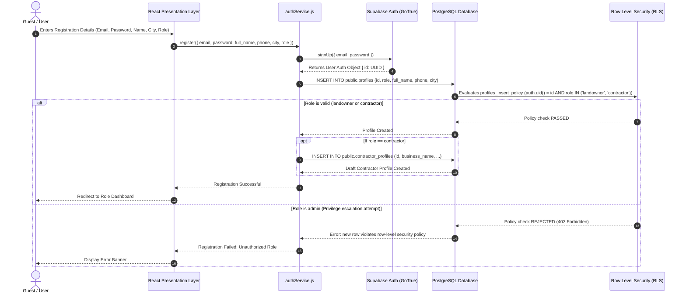
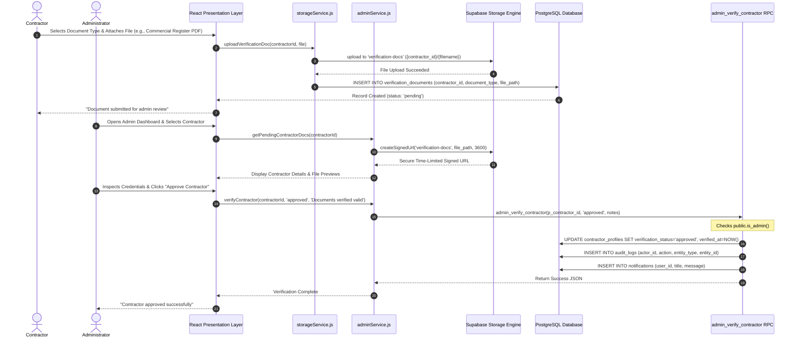
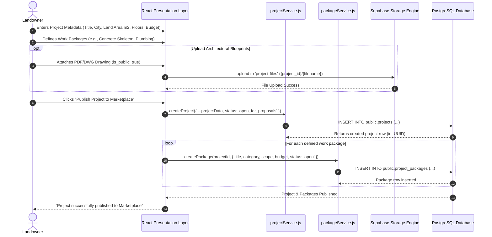
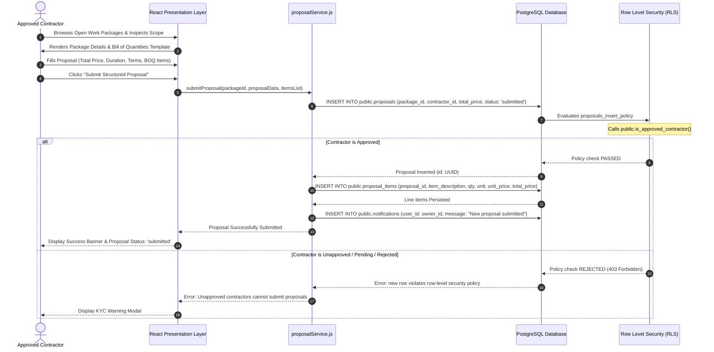
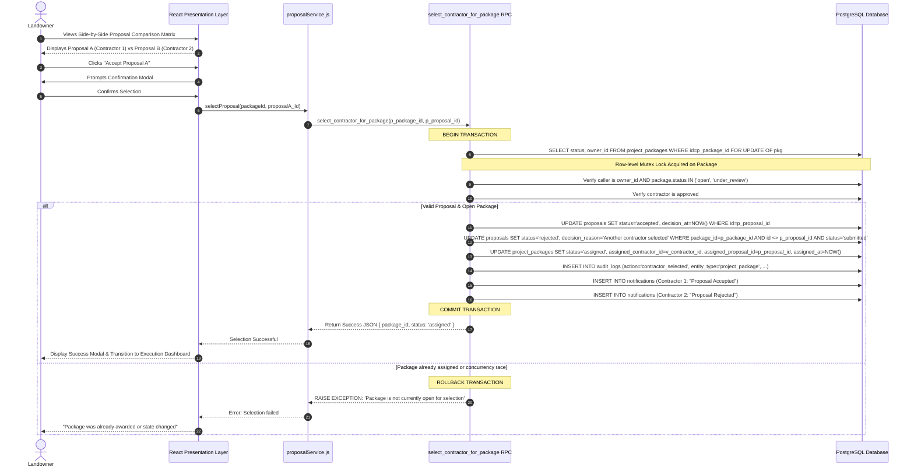
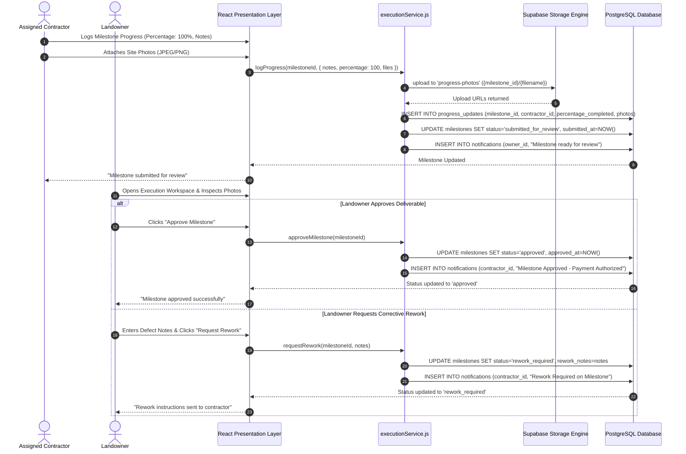
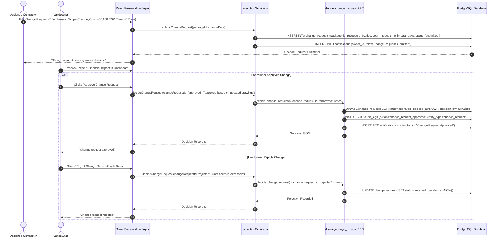
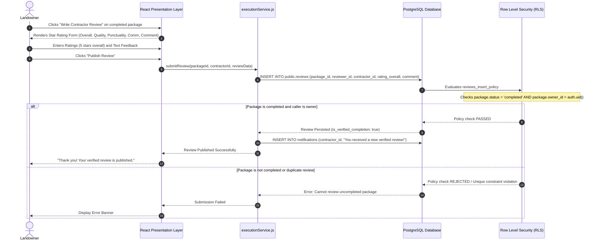

# BuildMatch — System Sequence Diagrams

| Document Metadata | Value |
| :--- | :--- |
| **Document ID** | BM-SAD-09 |
| **Document Purpose** | Formal sequence diagrams capturing chronological object interactions across all 9 critical system workflows |
| **System Name** | BuildMatch (بيلد ماتش) |
| **Version** | 1.0.0 |
| **Date** | 2026-11-16 |
| **Status** | Approved & Grounded in System Workflows |

---

## 1. Sequence Modeling Methodology

BuildMatch sequence diagrams depict dynamic interactions across the presentation layer, service abstraction layer, Supabase gateway, PostgreSQL engine, and Row Level Security (RLS) policies. Every diagram includes chronological numbering, lifeline activations, decision guards (`alt` / `opt`), and explicit failure branches.

---

## 2. Sequence Diagram 1: User Registration & Authentication

Illustrates role-based registration, GoTrue authentication, and database-level RLS policy enforcement blocking privilege escalation.



*(Source file preserved in `diagrams/sequence-01-auth.mmd`)*

---

## 3. Sequence Diagram 2: Contractor KYC Submission & Admin Review

Illustrates contractor document uploads to the private `verification-docs` storage bucket, secure signed URL generation for admin inspection, and atomic status transition via `admin_verify_contractor`.



*(Source file preserved in `diagrams/sequence-02-verification.mmd`)*

---

## 4. Sequence Diagram 3: Landowner Project Creation & Publication

Illustrates residential project creation, modular work package decomposition, drawing uploads, and publication to the open marketplace.



*(Source file preserved in `diagrams/sequence-03-project-creation.mmd`)*

---

## 5. Sequence Diagram 4: Project Discovery & Structured BOQ Bidding

Illustrates contractor marketplace discovery, package inspection, and structured proposal submission with database RLS verification checks.



*(Source file preserved in `diagrams/sequence-04-proposal-submission.mmd`)*

---

## 6. Sequence Diagram 5: Proposal Comparison & Atomic Contractor Selection

Illustrates landowner proposal comparison and atomic, concurrency-safe proposal selection via `select_contractor_for_package` RPC using PostgreSQL row-level locks.



*(Source file preserved in `diagrams/sequence-05-atomic-selection.mmd`)*

---

## 7. Sequence Diagram 6: Milestone Execution, Photo Evidence & Approval

Illustrates contractor progress logging, photographic evidence uploads to `progress-photos`, and landowner milestone approval or rework requests.



*(Source file preserved in `diagrams/sequence-06-milestone-lifecycle.mmd`)*

---

## 8. Sequence Diagram 7: Formal Change Request Submission & Decision

Illustrates formal scope, cost, and duration change management via `decide_change_request` RPC.



*(Source file preserved in `diagrams/sequence-07-change-request.mmd`)*

---

## 9. Sequence Diagram 8: Handover Request & Package Completion

Illustrates final contractual completion: contractor handover request via `request_package_handover` and landowner completion sign-off via `approve_package_completion`.

```mermaid
sequenceDiagram
  autonumber
  actor Contractor as Assigned Contractor
  actor Landowner as Landowner
  participant UI as React Presentation Layer
  participant ExecSvc as executionService.js
  participant RPC_H as request_package_handover RPC
  participant RPC_C as approve_package_completion RPC
  participant DB as PostgreSQL Database

  %% Step 1: Handover Request
  Note over Contractor,DB: Precondition: All package milestones are in 'approved' status
  Contractor->>UI: Clicks "Request Package Handover"
  UI->>ExecSvc: requestPackageHandover(packageId)
  ExecSvc->>RPC_H: request_package_handover(p_package_id)
  RPC_H->>DB: Verify all milestones have status='approved'
  RPC_H->>DB: UPDATE project_packages SET status='pending_handover', handover_requested_at=NOW()
  RPC_H->>DB: INSERT INTO audit_logs (action='handover_requested', ...)
  RPC_H->>DB: INSERT INTO notifications (owner_id, "Contractor requested final handover inspection")
  RPC_H-->>ExecSvc: Success JSON
  ExecSvc-->>UI: Package transitioned to 'pending_handover'
  UI-->>Contractor: "Handover request sent to landowner"

  %% Step 2: Final Completion Approval
  Landowner->>UI: Completes on-site physical walk-through
  Landowner->>UI: Clicks "Confirm & Approve Package Completion"
  UI->>ExecSvc: approvePackageCompletion(packageId)
  ExecSvc->>RPC_C: approve_package_completion(p_package_id)
  RPC_C->>DB: UPDATE project_packages SET status='completed', completed_at=NOW()
  RPC_C->>DB: Check parent project package statuses; update project if all complete
  RPC_C->>DB: INSERT INTO audit_logs (action='package_completed', ...)
  RPC_C->>DB: INSERT INTO notifications (contractor_id, "Package marked completed! Review unlocked.")
  RPC_C-->>ExecSvc: Success JSON
  ExecSvc-->>UI: Package status updated to 'completed'
  UI-->>Landowner: "Package completed! You can now write a review."
```

*(Source file preserved in `diagrams/sequence-08-handover-completion.mmd`)*

---

## 10. Sequence Diagram 9: Verified Review Submission

Illustrates post-completion rating submission and database RLS gate ensuring reviews can only be submitted after formal package completion.



*(Source file preserved in `diagrams/sequence-09-reviews.mmd`)*
