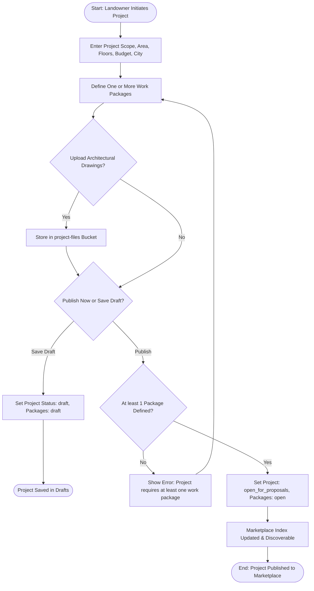
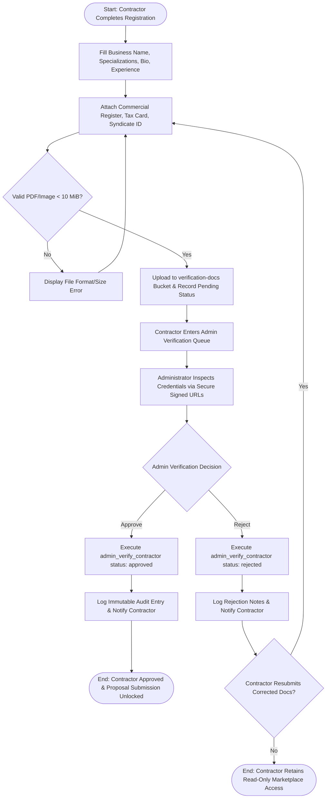
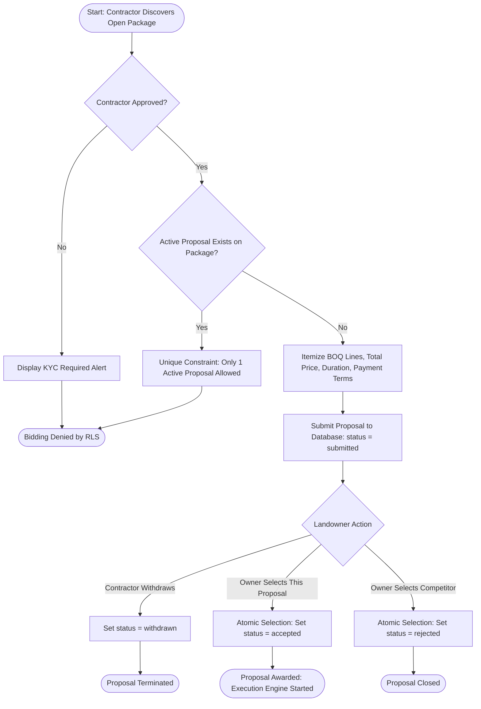
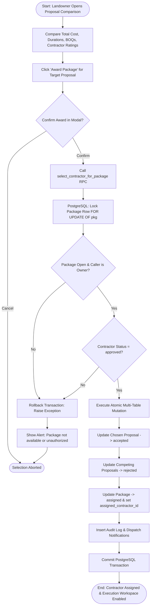
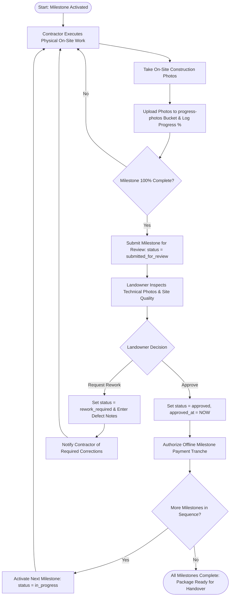
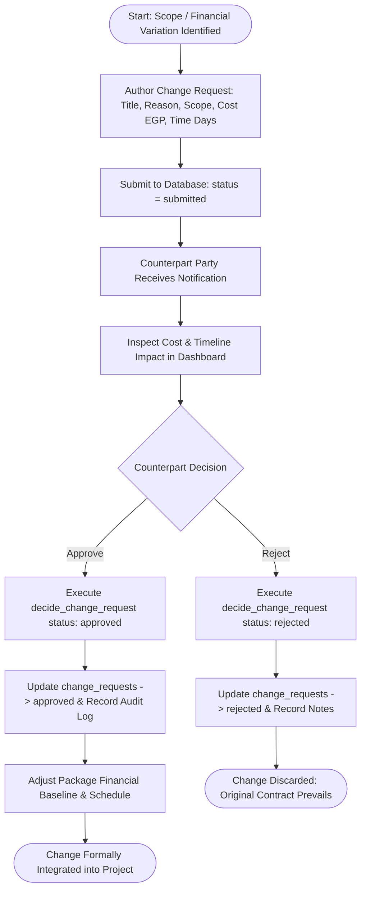
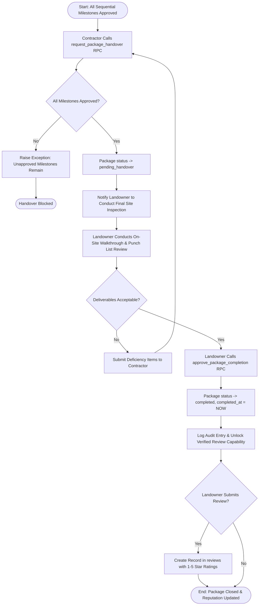

# BuildMatch — Business Process Activity Diagrams

| Document Metadata | Value |
| :--- | :--- |
| **Document ID** | BM-SAD-10 |
| **Document Purpose** | Comprehensive activity diagrams modeling operational control flow, decision branches, guards, and concurrency across all 7 core platform workflows |
| **System Name** | BuildMatch (بيلد ماتش) |
| **Version** | 1.0.0 |
| **Date** | 2026-11-16 |
| **Status** | Approved & Grounded in System Workflows |

---

## 1. Activity Modeling Framework

Activity diagrams represent the step-by-step operational workflows of the BuildMatch ecosystem, emphasizing:
- **Decision Nodes (`{}`):** Conditional branches and business rule guards.
- **Action States (`[]`):** Data transformations, API mutations, and physical human tasks.
- **Terminal Nodes (`([ ])`):** Start and end points of operational processes.
- **Exception Paths:** Error handling, validation failures, and rollback boundaries.

---

## 2. Activity Diagram 1: Project Creation & Publication

Models the landowner workflow from project initialization and multi-package breakdown to marketplace publication.

*(Source file preserved in `diagrams/activity-project-publication.mmd`)*

---

## 3. Activity Diagram 2: Contractor KYC Verification

Models the onboarding and due diligence lifecycle for contractors, including document submission and administrative review via `admin_verify_contractor`.

*(Source file preserved in `diagrams/activity-contractor-verification.mmd`)*

---

## 4. Activity Diagram 3: Proposal Lifecycle

Models proposal preparation, eligibility validation, itemized BOQ submission, withdrawal, and final state determination.

*(Source file preserved in `diagrams/activity-proposal-lifecycle.mmd`)*

---

## 5. Activity Diagram 4: Package Contractor Selection & Mutex Locking

Models the atomic contractor selection process, depicting PostgreSQL row-level locking (`FOR UPDATE OF pkg`) and transactional state transitions.

*(Source file preserved in `diagrams/activity-package-selection.mmd`)*

---

## 6. Activity Diagram 5: Construction Milestone Approval & Rework

Models the milestone execution cycle: physical execution, photographic evidence logging, landowner inspection, offline payment authorization, and corrective rework loops.

*(Source file preserved in `diagrams/activity-milestone-approval.mmd`)*

---

## 7. Activity Diagram 6: Change Request Governance

Models the formal contractual adjustment process when construction scope, pricing (EGP), or timeline (days) require modification during active construction.

*(Source file preserved in `diagrams/activity-change-request.mmd`)*

---

## 8. Activity Diagram 7: Project Handover & Completion Sign-Off

Models the final dual-party project handover, milestone audit gate, completion confirmation, and verified review unlock.

*(Source file preserved in `diagrams/activity-project-completion.mmd`)*
