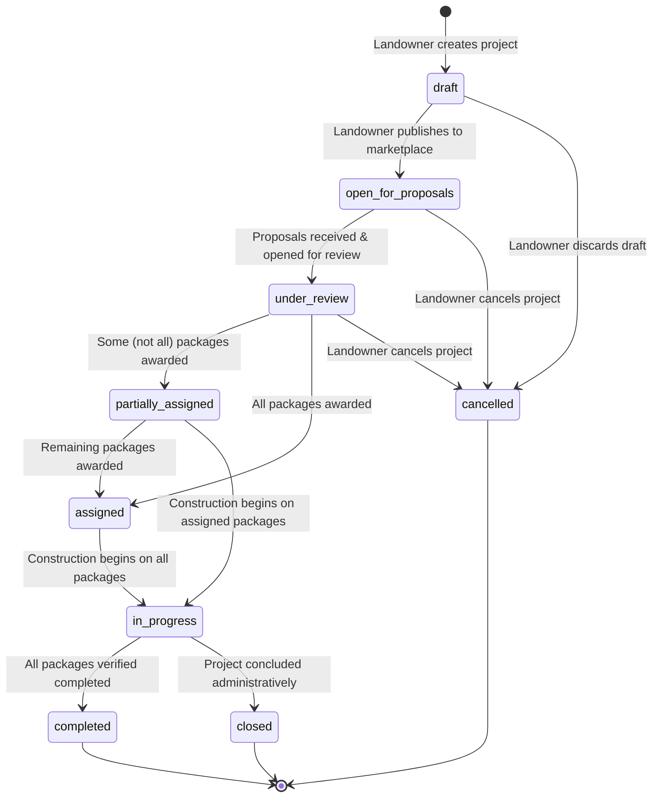
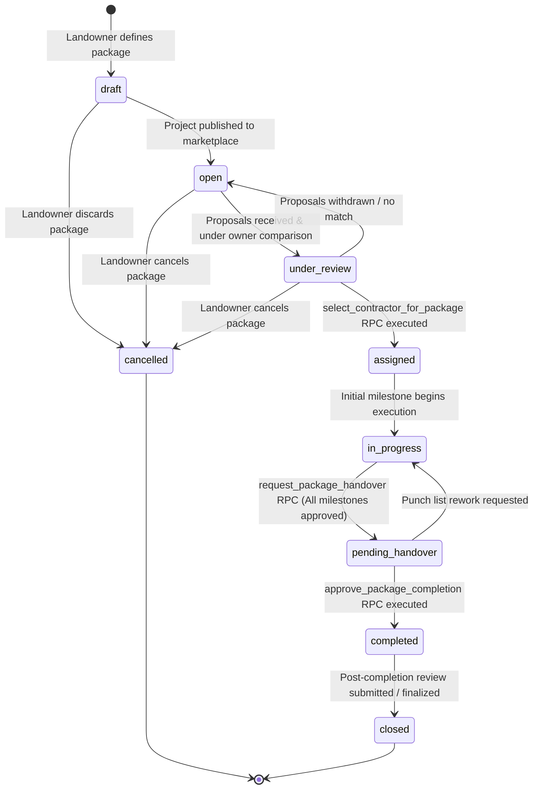
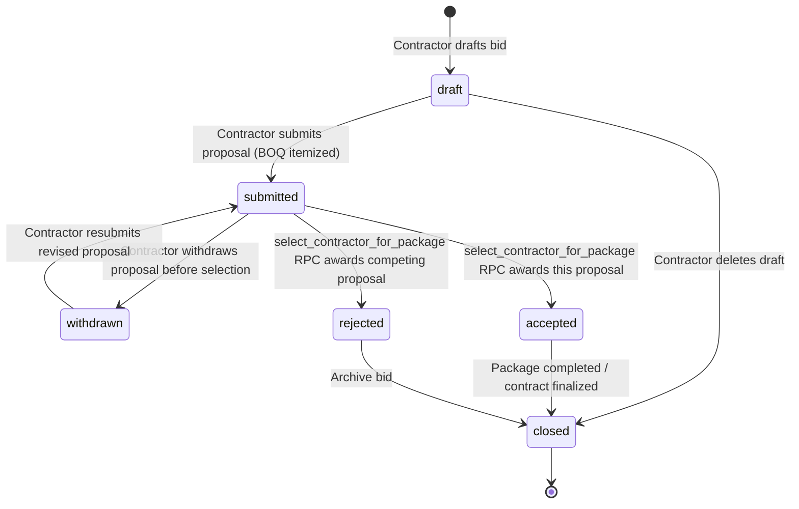
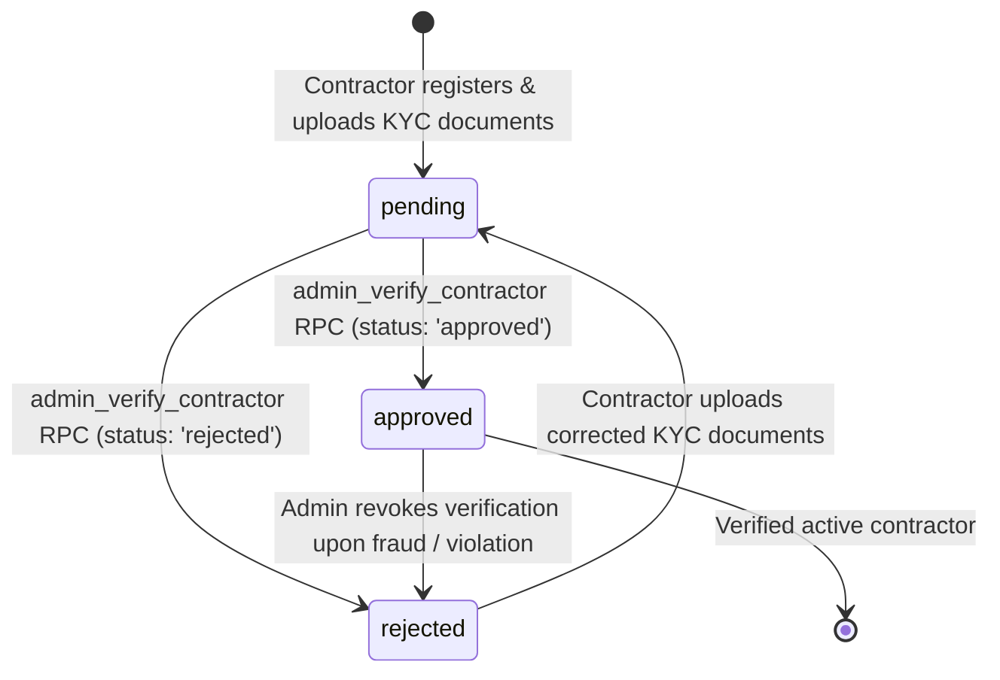
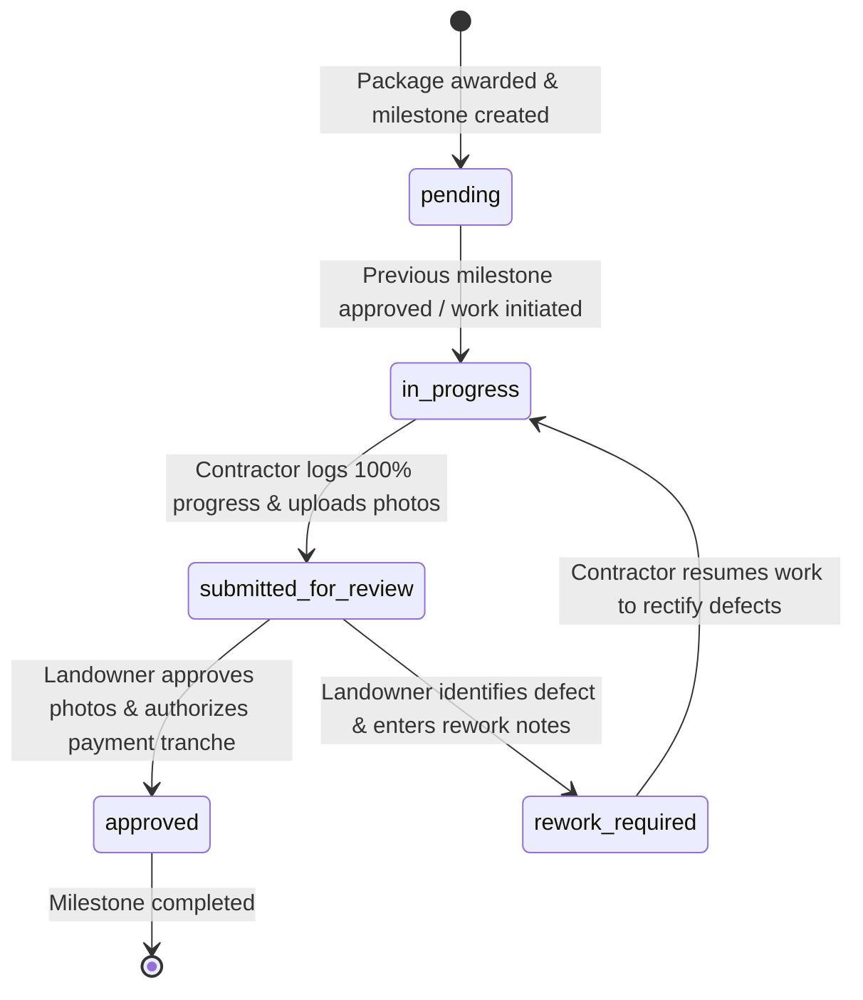
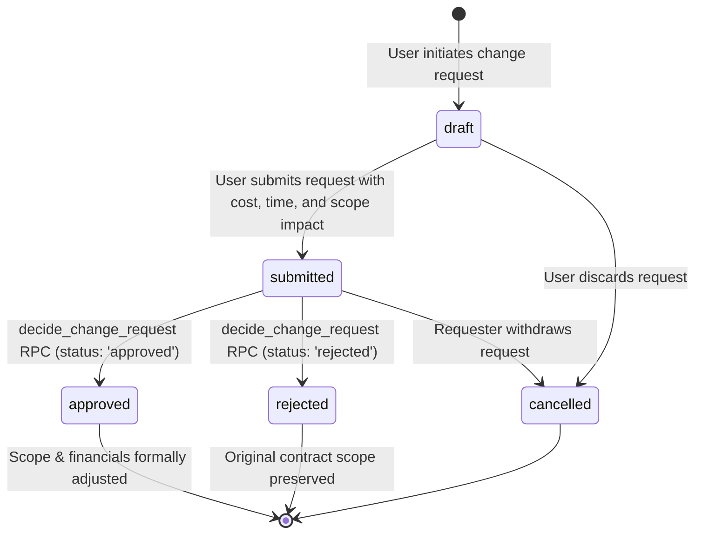

# BuildMatch — Entity State Machine Diagrams

| Document Metadata | Value |
| :--- | :--- |
| **Document ID** | BM-SAD-11 |
| **Document Purpose** | Formal state machine specifications, state transition matrices, triggering events, and guard conditions for all 6 core business entities |
| **System Name** | BuildMatch (بيلد ماتش) |
| **Version** | 1.0.0 |
| **Date** | 2026-11-16 |
| **Status** | Approved & Grounded in Schema Check Constraints |

---

## 1. State Modeling Methodology

Every state machine in BuildMatch is strictly bounded by check constraints defined in migration `20261116000001_initial_schema.sql`. Transitions between states are enforced either via client service mutations guarded by Row Level Security (RLS) or via atomic transactional PostgreSQL Remote Procedure Calls (RPCs).

---

## 2. Project State Machine

Controls the high-level residential construction project lifecycle across preparation, bidding, multi-package assignment, active construction, and closure.

*(Source file preserved in `diagrams/state-project.mmd`)*

### Transition Matrix: Project
| Current State | Target State | Triggering Event | Actor | Guard Condition |
| :--- | :--- | :--- | :--- | :--- |
| `draft` | `open_for_proposals` | Publish Project | Landowner | Project contains >= 1 valid work package |
| `open_for_proposals` | `under_review` | Open Proposals View | Landowner | >= 1 submitted proposal received |
| `under_review` | `partially_assigned`| Award Package | Landowner / RPC | Some (not all) child packages assigned |
| `under_review` | `assigned` | Award All Packages | Landowner / RPC | 100% of child packages assigned |
| `assigned` | `in_progress` | Start Execution | Landowner / Contractor| Initial milestones set to in_progress |
| `in_progress` | `completed` | All Packages Completed| Landowner / RPC | 100% of child packages in `completed` status |
| Any non-completed | `cancelled` | Cancel Project | Landowner | No active execution contracts in progress |

---

## 3. Work Package State Machine

Controls individual modular work packages, enabling independent multi-contractor assignment and milestone tracking.

*(Source file preserved in `diagrams/state-package.mmd`)*

### Transition Matrix: Work Package
| Current State | Target State | Triggering Event | Actor | Guard Condition |
| :--- | :--- | :--- | :--- | :--- |
| `draft` | `open` | Publish Project | Landowner | Parent project published |
| `open` | `under_review` | Compare Proposals | Landowner | >= 1 submitted proposal |
| `under_review` | `assigned` | Selection RPC | Landowner / RPC | `select_contractor_for_package` succeeds |
| `assigned` | `in_progress` | Milestone Started | Contractor | First milestone status becomes `in_progress` |
| `in_progress` | `pending_handover`| Handover Request | Contractor / RPC | 100% of milestones in `approved` status |
| `pending_handover`| `completed` | Completion Approval| Landowner / RPC | `approve_package_completion` RPC succeeds |
| `completed` | `closed` | Final Review / Archive| System / Owner | Package finalized |

---

## 4. Proposal State Machine

Governs contractor bidding from initial draft to final acceptance, rejection, or withdrawal.

*(Source file preserved in `diagrams/state-proposal.mmd`)*

### Transition Matrix: Proposal
| Current State | Target State | Triggering Event | Actor | Guard Condition |
| :--- | :--- | :--- | :--- | :--- |
| `draft` | `submitted` | Submit Proposal | Contractor | Contractor `is_approved_contractor() = true`; BOQ complete |
| `submitted` | `withdrawn` | Withdraw Proposal | Contractor | Package is still open (unawarded) |
| `submitted` | `accepted` | Selection RPC | Landowner / RPC | `select_contractor_for_package` awards this proposal |
| `submitted` | `rejected` | Selection RPC | Landowner / RPC | `select_contractor_for_package` awards competing proposal |
| `accepted` | `closed` | Project Handover | System | Package completion approved |

---

## 5. Contractor KYC Verification State Machine

Controls platform due diligence, licensing document review, and contractor verification status.

*(Source file preserved in `diagrams/state-contractor-verification.mmd`)*

---

## 6. Construction Milestone State Machine

Controls execution deliverables, photographic inspection, payment gates, and corrective rework loops.

*(Source file preserved in `diagrams/state-milestone.mmd`)*

---

## 7. Change Request State Machine

Governs scope, cost (+/- EGP), and timeline (days) variations during construction execution.

*(Source file preserved in `diagrams/state-change-request.mmd`)*
