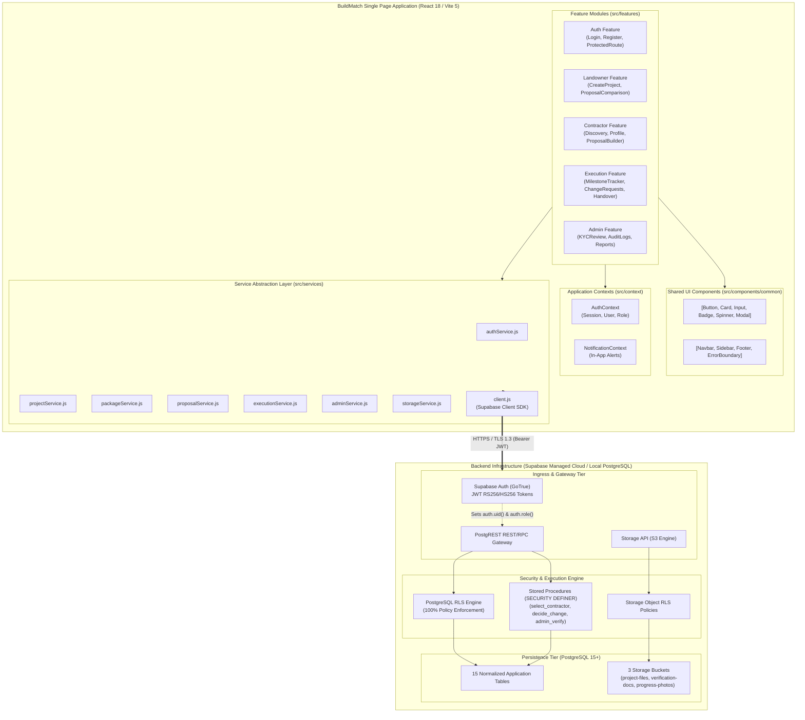

# BuildMatch — Software Component Architecture

| Document Metadata | Value |
| :--- | :--- |
| **Document ID** | BM-SAD-13 |
| **Document Purpose** | Structural component diagram, interface specifications, internal dependencies, and trust boundary mapping |
| **System Name** | BuildMatch (بيلد ماتش) |
| **Version** | 1.0.0 |
| **Date** | 2026-11-16 |
| **Status** | Approved & Grounded in Repository Codebase |

---

## 1. Component Architecture Overview

BuildMatch follows a component-based architectural structure built around **React 18** and **Vite 5** on the client side, interfacing with a **PostgreSQL/Supabase** Backend-as-a-Service (BaaS). The architecture enforces strict separation of concerns across presentation components, application feature controllers, state contexts, and data access services.

---

## 2. Component Diagram



*(Source file preserved in `diagrams/component-diagram.mmd`)*

---

## 3. Client Component Breakdown

### 3.1 Presentation & Shared UI Library (`src/components/common/`)
- **`Button.jsx`:** Polymorphic button supporting primary, secondary, outline, danger variants, loading state spinners, and disabled states.
- **`Card.jsx`:** Flexible container component with header, body, and footer subdivisions.
- **`Input.jsx`:** Accessible form control supporting text, email, password, number, and textarea inputs with integrated validation error message rendering.
- **`Badge.jsx`:** Status indicator badge supporting dynamic colors for entity states (`draft`, `open`, `assigned`, `approved`, `rejected`, `completed`).
- **`Spinner.jsx`:** Accessible SVG loading animation indicator.
- **`Modal.jsx`:** Accessible dialog component with focus trapping, backdrop blur, and escape key cancellation.
- **`ErrorBoundary.jsx`:** React class component implementing `componentDidCatch()` to catch unhandled rendering exceptions and display a recovery UI.

### 3.2 State & Context Layer (`src/context/`)
- **`AuthContext.jsx`:** Manages user session state, JWT token persistence, active user role (`landowner`, `contractor`, `admin`), and exposes `login()`, `logout()`, `register()`, and `refreshProfile()`.
- **`NotificationContext.jsx`:** Subscribes to user notifications, manages unread counts, and displays floating toast alerts.

### 3.3 Service Abstraction Layer (`src/services/`)
- **`client.js`:** Single point of initialization for `@supabase/supabase-js`. Consumes public environment variables `VITE_SUPABASE_URL` and `VITE_SUPABASE_ANON_KEY`. Enforces zero inclusion of `service_role`.
- **`authService.js`:** Wraps Supabase Auth and profile bootstrapping.
- **`projectService.js`:** Encapsulates project CRUD, status filtering, and metadata updates.
- **`packageService.js`:** Handles work package partitioning and marketplace discovery.
- **`proposalService.js`:** Handles proposal submission, BOQ item persistence, and calls `select_contractor_for_package` RPC.
- **`executionService.js`:** Handles milestone progress logging, change requests, handover requests, and verified reviews.
- **`adminService.js`:** Dispatches verification RPCs and fetches audit logs.
- **`storageService.js`:** Encapsulates file uploads, signed URL generation, and MIME validation.

---

## 4. Backend Component Breakdown

### 4.1 Ingress & Gateway Tier
- **Supabase Auth (GoTrue):** Standalone OAuth2/JWT authentication daemon generating RS256/HS256 signed JSON Web Tokens containing user ID and claims.
- **PostgREST API Gateway:** High-performance web server translating HTTP GET/POST/PATCH/DELETE requests directly into parameterized SQL queries executed under the authenticated user's PostgreSQL role.
- **Supabase Storage API:** S3-compatible file storage gateway managing object metadata, multipart uploads, and streaming downloads.

### 4.2 Security & Persistence Engine
- **PostgreSQL 15+ Engine:** Core transactional database executing queries with ACID guarantees.
- **Row Level Security (RLS) Engine:** Enforces declarative row-level access control on every table query.
- **PL/pgSQL Procedural RPC Engine:** Executes sensitive multi-step business transactions under `SECURITY DEFINER` with explicit `search_path = public, auth, pg_temp;`.
- **Object Storage Buckets:** Private S3-backed storage volumes (`project-files`, `verification-docs`, `progress-photos`).

---

## 5. Trust Boundaries & Security Enclaves

```
+-----------------------------------------------------------------------------------------------+
|                                    TRUST BOUNDARY SPECIFICATION                               |
+-----------------------------------------------------------------------------------------------+
| [UNTRUSTED CLIENT ZONE]                                                                       |
|   User Browser (React SPA, Local Storage, In-Memory Session)                                  |
|   * Assumed vulnerable to client-side DOM manipulation or script inspection.                   |
|   * Only public anonymous API keys (anon_key) are trusted in this zone.                       |
+-----------------------------------------------------------------------------------------------+
                                               ||
                          [NETWORK TRUST BOUNDARY: TLS 1.3]
                                               ||
+-----------------------------------------------------------------------------------------------+
| [TRUSTED GATEWAY ZONE]                                                                        |
|   Supabase Ingress (GoTrue, PostgREST, Storage API)                                           |
|   * Validates JWT signatures and parses auth.uid() claims.                                     |
+-----------------------------------------------------------------------------------------------+
                                               ||
                          [DATABASE INTERNAL TRUST BOUNDARY]
                                               ||
+-----------------------------------------------------------------------------------------------+
| [ISOLATED SECURE PERSISTENCE ENCLAVE]                                                         |
|   PostgreSQL Engine + RLS Engine + PL/pgSQL Stored Procedures                                 |
|   * 100% data access mediated through RLS policies. Direct table access without policies is   |
|     impossible. Immutable audit logs cannot be modified by any client.                         |
+-----------------------------------------------------------------------------------------------+
```
