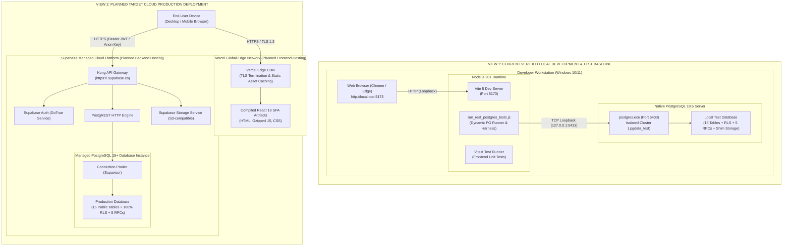

# BuildMatch — Deployment Architecture Specification

| Document Metadata | Value |
| :--- | :--- |
| **Document ID** | BM-SAD-14 |
| **Document Purpose** | Deployment architecture specification detailing current verified local testing foundation and planned target cloud infrastructure |
| **System Name** | BuildMatch (بيلد ماتش) |
| **Version** | 1.0.0 |
| **Date** | 2026-11-16 |
| **Status** | View 1 Implemented & Verified; View 2 Planned Target |

---

## 1. Deployment Architecture Overview

BuildMatch strictly distinguishes between:
1. **Current Local Development & Test Baseline:** The empirically verified environment currently operating on the local workstation, running genuine native PostgreSQL 18.6 for full database and security testing.
2. **Planned Target Cloud Production Deployment:** The target cloud deployment model engineered for production hosting on Vercel and Supabase Cloud.

> [!IMPORTANT]
> **Cloud Status Transparency:**
> As of this System Analysis & Design documentation baseline, the remote Supabase Cloud project has **not** yet been provisioned, and no production migrations have been pushed. All database schema migrations and RLS security policies have been executed and validated against a clean, isolated local PostgreSQL 18.6 test cluster.

---

## 2. Deployment Diagrams: Current Local vs. Planned Cloud

*(Source file preserved in `diagrams/deployment-diagram.mmd`)*

---

## 3. View 1: Current Verified Local Testing Baseline

The local environment is configured for deterministic, reproducible verification without cloud network dependencies:

| Component | Host / Runtime | Port / Interface | Architectural Role |
| :--- | :--- | :--- | :--- |
| **Vite Dev Server** | Node.js v20+ on Windows | `http://localhost:5173` | Serves hot-reloading React 18 frontend with ES modules. |
| **Vitest Runner** | Node.js v20+ / jsdom | CLI (`npm run test`) | Executes component rendering and unit test assertions. |
| **Database Harness** | Node.js (`pg` client) | CLI (`npm run test:db`)| Spawns temporary PostgreSQL cluster, runs migrations, executes tests. |
| **PostgreSQL 18.6** | Native `postgres.exe` | TCP `127.0.0.1:5433` | Isolated data directory `.pgdata_test` with superuser credentials. |
| **Auth/Storage Shims** | SQL Functions in PG | Database internal | Provides `auth.uid()`, `auth.role()`, and `storage.objects` shims for local testing. |

### Local Automated Verification Baseline
Executing `npm run test:db` performs the following sequence on the local workstation:
1. Detects native PostgreSQL binaries (`C:\Program Files\PostgreSQL\18\bin`).
2. Initializes an isolated test cluster using `initdb` with port `5433`.
3. Spawns `postgres.exe` with socket logging.
4. Executes two clean cycles of all 4 SQL migrations and seed data from zero.
5. Runs 13 runtime security assertions validating anonymous blocking, multi-tenant storage isolation, KYC privacy, and role escalation defenses.
6. Executes 2-client concurrent proposal selection with separate TCP connections, asserting mutex row locking.
7. Shuts down the temporary PostgreSQL cluster cleanly.

---

## 4. View 2: Planned Target Cloud Production Deployment

The target cloud architecture provides high availability, global caching, automated backups, and managed security:

### 4.1 Frontend Tier: Vercel Edge Network
- **Hosting Platform:** Vercel Global Edge Network.
- **Artifacts:** Pre-compiled static assets produced by `npm run build` (`dist/`).
- **Optimization:** Automatic Gzip/Brotli compression, HTTP/2 and HTTP/3 multiplexing, asset hashing, and edge cache invalidation upon Git push to `main`.
- **Custom Domain:** `https://buildmatch.eg` (Planned) with automatic SSL/TLS certificate renewal via Let's Encrypt.

### 4.2 Backend Tier: Supabase Cloud Managed Platform
- **Hosting Region:** Frankfurt (`eu-central-1`) or Bahrain (`me-central-1`) to minimize round-trip latency to Egyptian clients (< 70 ms).
- **Kong API Gateway:** TLS termination, API routing, and rate limiting (preventing brute-force attacks on auth endpoints).
- **Supabase Auth (GoTrue):** Managed user session service with email verification and JWT token issuance.
- **PostgREST Gateway:** Stateless HTTP-to-SQL translation with automatic connection pooling.
- **Supabase Storage Service:** S3-compatible multi-region object storage with CDN acceleration.
- **PostgreSQL 15+ Engine:** Managed relational instance with point-in-time recovery (PITR), daily automated backups, and connection pooling via Supavisor.

---

## 5. Environment Variables & Secret Management

BuildMatch enforces strict environment segregation to prevent credential leakage.

### 5.1 Client-Side Environment Variables (`.env`)
Only public, non-sensitive configuration values are bundled into the client build:

| Variable Name | Environment | Description | Sensitivity |
| :--- | :--- | :--- | :--- |
| `VITE_SUPABASE_URL` | Local / Prod | Base URL of the Supabase API Gateway (`https://<project-ref>.supabase.co`) | Public Configuration |
| `VITE_SUPABASE_ANON_KEY` | Local / Prod | Public Anonymous JWT key for PostgREST client queries | Public Anonymous Key |
| `VITE_APP_ENV` | Local / Prod | Environment identifier (`development`, `production`, `test`) | Public Configuration |

### 5.2 Server-Side & Administrative Secrets (NEVER in Client Code)
| Variable / Secret | Permitted Location | Purpose |
| :--- | :--- | :--- |
| `SUPABASE_SERVICE_ROLE_KEY` | CI/CD Secrets / Admin Scripts Only | Bypasses RLS for administrative migrations and system maintenance. Strictly forbidden in frontend code. |
| `POSTGRES_PASSWORD` | Local Test Harness / Cloud Console | Master superuser database password. Never committed to Git. |
| `JWT_SECRET` | Supabase Cloud Console | Cryptographic secret used to sign and verify user session tokens. |
