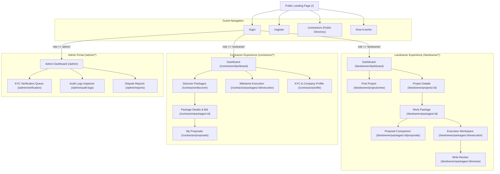

# BuildMatch — UI/UX Design Guidelines & Screen Specifications

| Document Metadata | Value |
| :--- | :--- |
| **Document ID** | BM-SAD-15 |
| **Document Purpose** | Comprehensive UI/UX design guidelines, role-specific information architecture, navigation maps, design system tokens, low-fidelity wireframe specifications, and accessibility rules |
| **System Name** | BuildMatch (بيلد ماتش) |
| **Version** | 1.0.0 |
| **Date** | 2026-11-16 |
| **Status** | Approved Specification |

---

## 1. UI/UX Vision & Design Principles

BuildMatch provides an intuitive, trustworthy, and engineering-grade user experience tailored to the Egyptian residential construction market:

1. **Clarity Over Complexity:** Construction contracts involve complex technical specifications. Interfaces prioritize itemized tables, visual progress meters, and side-by-side matrices over cluttered forms.
2. **Native Arabic Experience (RTL First):** The primary user interface is natively designed for right-to-left (RTL) reading order, featuring clean Arabic typography (Cairo / Tajawal font stacks), with full technical English (LTR) parity for engineering terms.
3. **Transparency & Trust Signals:** Trust is paramount. Verified badges, itemized BOQs, timestamped photo evidence, and immutable audit badges are prominently featured.
4. **State Completeness:** Every interface cleanly handles four fundamental UI states: **Loading**, **Empty**, **Error**, and **Success**.
5. **Confirmation for Irreversible Actions:** Irreversible or financially critical actions (contractor award, change request decision, project cancellation) mandate explicit confirmation dialogs detailing consequences.

> [!NOTE]
> **Figma Design Scope Demarcation:**
> This document specifies the architectural information hierarchy, navigation flows, and low-fidelity ASCII wireframes. The detailed visual polish, high-fidelity color mockups, and interactive prototype are maintained in the companion UI/UX design workstream (`docs/04-ui-ux/`).

---

## 2. Information Architecture & Navigation Map



*(Source file preserved in `diagrams/navigation-map.mmd`)*

---

## 3. Design Tokens & Visual Hierarchy

### 3.1 Color Palette
- **Primary Brand (Construction Steel Blue):** `#1E3A8A` (Tailwind `blue-900`) — Primary navigation, primary action buttons, branding.
- **Secondary Accent (Safety Amber / Gold):** `#D97706` (Tailwind `amber-600`) — Highlights, verified badges, rating stars, callouts.
- **Neutral Backgrounds:**
  - Page Background: `#F8FAFC` (Tailwind `slate-50`).
  - Surface Cards: `#FFFFFF` (White).
  - Borders & Dividers: `#E2E8F0` (Tailwind `slate-200`).
- **Semantic Status Colors:**
  - `Draft / Pending`: `#64748B` (Slate)
  - `Open / In Progress`: `#2563EB` (Blue)
  - `Submitted / Under Review`: `#D97706` (Amber)
  - `Approved / Accepted / Completed`: `#16A34A` (Green)
  - `Rejected / Cancelled`: `#DC2626` (Red)

### 3.2 Typography
- **Arabic Font Family:** Cairo, Tajawal, system-ui, sans-serif.
- **English Font Family:** Inter, system-ui, sans-serif.
- **Scale:**
  - H1 Page Titles: `2rem` (32px), Font-weight: Bold (`700`).
  - H2 Section Titles: `1.5rem` (24px), Font-weight: SemiBold (`600`).
  - Body Text: `1rem` (16px), Line-height: `1.5` (24px).
  - Metadata / Captions: `0.875rem` (14px), Font-weight: Normal (`400`).

---

## 4. Low-Fidelity Wireframe Specifications

### 4.1 Wireframe 1: Proposal Comparison Matrix (Landowner View)
```text
+----------------------------------------------------------------------------------------------------+
| [BuildMatch Logo]     My Projects  |  Notifications (2)  |  Account: Ahmed (Landowner)     [Logout]|
+----------------------------------------------------------------------------------------------------+
| < Back to Project: New Cairo Villa #142                                                            |
| Work Package: Concrete Skeleton (الهيكل الخرساني) | Budget: 1,200,000 EGP | Status: Under Review    |
+----------------------------------------------------------------------------------------------------+
| PROPOSAL COMPARISON MATRIX (3 Bids Submitted)                                                      |
+------------------------------------+-----------------------------------+---------------------------+
| CRITERIA                           | PROPOSAL A (Al-Ahram Contracting) | PROPOSAL B (El-Nile Const)|
+------------------------------------+-----------------------------------+---------------------------+
| Contractor Status                  | [VERIFIED CONTRACTOR]             | [VERIFIED CONTRACTOR]     |
| Contractor Rating                  | ★ 4.8 (14 Reviews)                | ★ 4.5 (8 Reviews)         |
| Total Bid Price                    | 1,150,000 EGP [LOWEST BID]        | 1,220,000 EGP             |
| Proposed Duration                  | 90 Days [FASTEST]                 | 110 Days                  |
| Advance Payment Term               | 15% upon signing                  | 20% upon signing          |
| Raw Materials Included?            | Yes (Concrete + Steel included)   | Labor only (المصنعية فقط) |
| Itemized BOQ Lines                 | 6 Lines Specified [View Details]  | 4 Lines Specified [View]  |
| Milestone Payment Structure        | 4 Tranches (Tied to Inspections)  | 3 Tranches                |
+------------------------------------+-----------------------------------+---------------------------+
| ACTION                             | [ ACCEPT PROPOSAL A ]             | [ ACCEPT PROPOSAL B ]     |
|                                    | (Triggers Atomic Selection RPC)   |                           |
+------------------------------------+-----------------------------------+---------------------------+
```

### 4.2 Wireframe 2: Milestone Execution & Photographic Proof (Contractor View)
```text
+----------------------------------------------------------------------------------------------------+
| [BuildMatch Logo]     Discover  |  My Proposals  |  Active Work (1)  |  Company: Al-Ahram  [Logout]|
+----------------------------------------------------------------------------------------------------+
| Project: New Cairo Villa #142 | Package: Concrete Skeleton | Owner: Ahmed Hassan                   |
| Overall Progress: [████████████████░░░░░░░░] 60% Complete                                          |
+----------------------------------------------------------------------------------------------------+
| MILESTONE TIMELINE:                                                                                |
| 1. Excavation & Soil Compaction  [ APPROVED - Payment Authorized: 180,000 EGP ]                   |
| 2. Foundation Footings (القواعد العادية والمسلحة) [ APPROVED - Payment Authorized: 320,000 EGP ]   |
| 3. Ground Floor Columns (أعمدة الأرضي) [ IN PROGRESS - Active Milestone ]                          |
| 4. First Floor Slab (سقف الأرضي) [ PENDING ]                                                      |
+----------------------------------------------------------------------------------------------------+
| ACTIVE MILESTONE: Ground Floor Columns (أعمدة الأرضي)                                              |
| Completion Percentage: [ 100% ]                                                                    |
| Technical Progress Notes:                                                                          |
| [ Reinforcement steel inspection completed by engineering consultant. Concrete pouring scheduled.] |
+----------------------------------------------------------------------------------------------------+
| PHOTOGRAPHIC EVIDENCE (Mandatory before review submission):                                        |
| +-------------------------+ +-------------------------+ +-------------------------+                |
| | [photo1.jpg]            | | [photo2.jpg]            | | [ + UPLOAD PHOTO ]      |                |
| | Rebar Spacing Quality   | | Column Forms Alignment  | | (JPEG/PNG < 15 MiB)     |                |
| +-------------------------+ +-------------------------+ +-------------------------+                |
|                                                                                                    |
| [ SUBMIT MILESTONE FOR OWNER REVIEW ]  |  [ + INITIATE CHANGE REQUEST ]                            |
+----------------------------------------------------------------------------------------------------+
```

---

## 5. Responsive Breakpoint Guidelines

BuildMatch conforms to responsive web standards across three primary viewport tiers:

| Viewport Tier | Breakpoint | Layout Adaptations |
| :--- | :--- | :--- |
| **Mobile** | `< 640px` | Single-column vertical layout. Comparison matrix transforms from wide table into swipeable horizontal cards. Fixed bottom action bar for primary mutations. Hamburger menu for navigation. |
| **Tablet** | `640px – 1024px` | 2-column grid for project lists and forms. Sidebar collapses into icon-only rail or drawer. Comparison matrix displays 2 side-by-side cards with horizontal scrolling. |
| **Desktop** | `> 1024px` | Full multi-column layout. Comparison matrix renders up to 4 contractor bids side-by-side. Sticky sidebar for quick navigation and progress metrics. |

---

## 6. Accessibility & Error Handling Guidelines

1. **Color Contrast:** All textual labels maintain a minimum contrast ratio of `4.5:1` against their backgrounds (WCAG 2.1 Level AA). Status badge text uses bold weights to enhance legibility.
2. **Keyboard Navigation:** All interactive elements (`Button`, `Modal`, `Input`, `Card` links) feature visible focus rings (`ring-2 ring-blue-600 ring-offset-2`) and support Tab/Enter/Escape keyboard shortcuts.
3. **Form Error Rendering:** Errors are displayed immediately beneath the invalid input control in high-contrast red text (`text-red-600 text-sm`) with an accessible `aria-invalid="true"` attribute.
4. **Destructive Action Guards:** Destructive actions (canceling projects, rejecting change requests, awarding contractors) trigger a `Modal` dialog requiring explicit confirmation, explaining consequences in plain Arabic and English.
