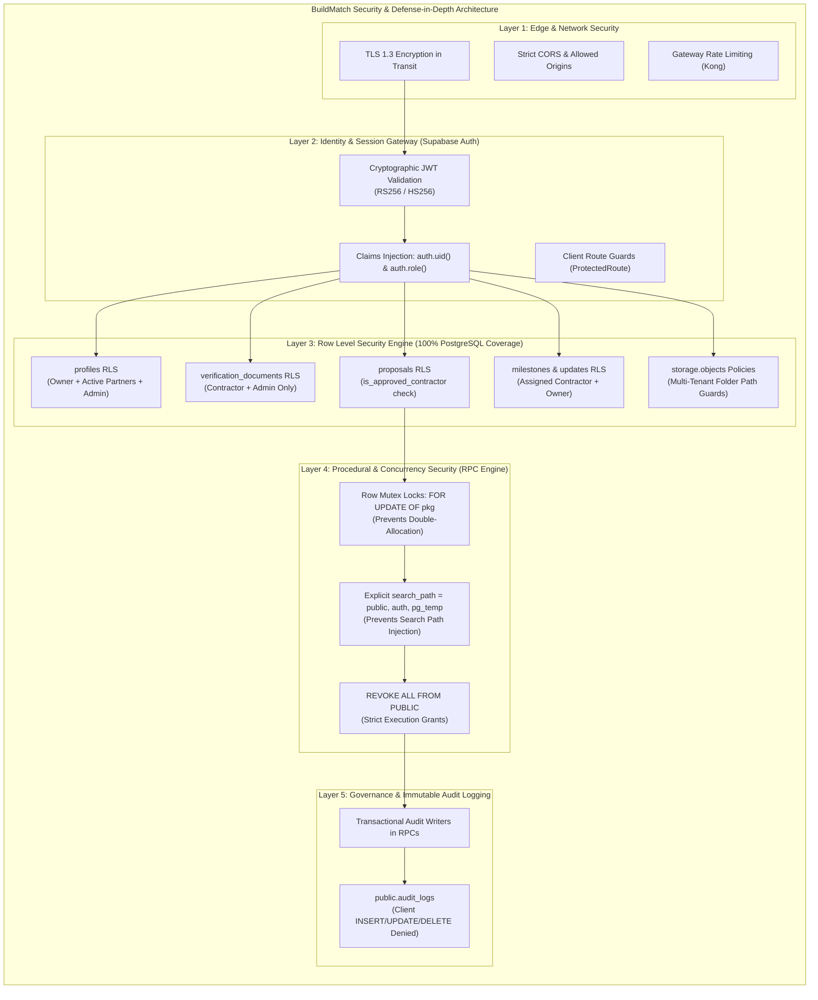

# BuildMatch — Security & Authorization Architecture

| Document Metadata | Value |
| :--- | :--- |
| **Document ID** | BM-SAD-17 |
| **Document Purpose** | Comprehensive security architecture, defense-in-depth model, Row Level Security (RLS) policies, storage protections, and privilege controls |
| **System Name** | BuildMatch (بيلد ماتش) |
| **Version** | 1.0.0 |
| **Date** | 2026-11-16 |
| **Status** | Implemented & Verified in Migrations 01 - 04 (13/13 Security Tests Passing) |

---

## 1. Security Architecture & Defense-in-Depth Model

BuildMatch enforces a **Defense-in-Depth** security architecture structured across five concentric security perimeters:



*(Source file preserved in `diagrams/security-architecture.mmd`)*

---

## 2. Role-Based Access Control (RBAC) Framework

BuildMatch classifies users into four fundamental access roles:

| Role Name | Scope & Authority | Primary Responsibilities |
| :--- | :--- | :--- |
| **`anon` (Guest)** | Unauthenticated Visitor | Read-only access to platform marketing pages and approved contractor directory via stripped view. All private user tables completely denied. |
| **`landowner`** | Asset Owner / Consumer | Full ownership CRUD over own projects, work packages, and drawing files. Can read submitted proposals on own packages, execute proposal selection, sign off on milestones, and submit reviews. |
| **`contractor`** | Service Provider / Builder | Can manage company profile, upload KYC files, discover open marketplace packages, submit structured proposals (upon approval), log milestone updates with photos, and submit change requests. |
| **`admin`** | Platform Governance Officer | Privileged authority to review KYC applications, verify contractors, moderate disputes, resolve reports, and inspect immutable system audit logs. |

---

## 3. Row Level Security (RLS) Policy Specifications

### 3.1 Profiles Table Hardening: Elimination of `USING (true)`
In migration `20261116000002_rls_policies.sql`, the broad `USING (true)` policy was eliminated and replaced with strict multi-tenant authorization:

```sql
CREATE POLICY "profiles_select_policy"
  ON public.profiles FOR SELECT
  USING (
    auth.uid() = id
    OR public.is_admin()
    OR EXISTS (
      SELECT 1 FROM public.project_packages pkg
      JOIN public.projects p ON p.id = pkg.project_id
      WHERE (
        (p.owner_id = auth.uid() AND pkg.assigned_contractor_id = profiles.id)
        OR (pkg.assigned_contractor_id = auth.uid() AND p.owner_id = profiles.id)
      )
      AND pkg.status IN ('assigned', 'in_progress', 'pending_handover')
    )
  );
```
- **Rules Enforced:**
  1. Users can always read their own complete profile.
  2. Platform administrators can inspect all profiles for compliance.
  3. Active project collaborators (the landowner and the assigned contractor on an active package) can view each other's contact details to facilitate on-site coordination.
  4. Unrelated third parties and anonymous users cannot read private profile records.

### 3.2 Role Escalation Prevention
```sql
CREATE POLICY "profiles_insert_policy"
  ON public.profiles FOR INSERT
  WITH CHECK (
    auth.uid() = id AND role IN ('landowner', 'contractor')
  );

CREATE POLICY "profiles_update_policy"
  ON public.profiles FOR UPDATE
  USING (auth.uid() = id OR public.is_admin())
  WITH CHECK (
    (auth.uid() = id AND role = (SELECT p.role FROM public.profiles p WHERE p.id = auth.uid()))
    OR public.is_admin()
  );
```
- Users are strictly blocked from self-registering as `admin`.
- Profile updates verify that `role` remains unchanged for non-administrators.

### 3.3 Contractor KYC & Document Privacy
- **Table `verification_documents`:** Access restricted strictly to the uploading contractor (`contractor_id = auth.uid()`) and platform administrators (`public.is_admin() = true`). Landowners and competitor contractors receive 0 rows.
- **Table `contractor_profiles`:** Unverified or pending contractors are visible only to themselves and administrators. Approved contractors are queryable by authenticated users for marketplace discovery.

### 3.4 Proposal Confidentiality & Active Bid Constraint
- Contractors can only read and update their own submitted proposals (`contractor_id = auth.uid()`).
- Landowners can read proposals submitted to work packages they own.
- Competing contractors cannot read each other's bids or itemized BOQs prior to selection.
- Unique partial index `uq_contractor_active_proposal_per_package` restricts contractors to at most one active proposal per package.

---

## 4. Multi-Tenant Storage Object Security

In migration `20261116000004_storage_buckets.sql`, all three storage buckets are private (`public = false`) and protected via SQL policies on `storage.objects`:

| Storage Bucket | Access Path Format | Read (SELECT) Policy Rule | Insert / Delete Policy Rule |
| :--- | :--- | :--- | :--- |
| **`project-files`** | `{project_id}/{file_name}` | Project owner, assigned contractor on active package, or authenticated user if `is_public = true` on open project. | Project owner only (`p.owner_id = auth.uid()`). |
| **`verification-docs`** | `{contractor_id}/{file_name}` | Uploading contractor (`contractor_id = auth.uid()`) or admin (`is_admin()`). | Uploading contractor only. |
| **`progress-photos`** | `{package_id}/{milestone_id}/{file_name}` | Project owner, assigned contractor on package, or admin. | Assigned contractor on that package only (`pkg.assigned_contractor_id = auth.uid()`). |

> [!NOTE]
> **Storage Authorization Scope:**
> The `progress_photos_storage_select` and `progress_photos_storage_insert` policies evaluate access using `(storage.foldername(name))[1]`, which corresponds to `package_id`. Authorization is therefore enforced at the **package assignment level** (ensuring the contractor is assigned to that package and the landowner owns that package's project), rather than checking milestone-level ownership directly.

---

## 5. Stored Procedure (RPC) Hardening & Concurrency Safety

All transactional stored procedures in `20261116000003_functions_and_rpc.sql` comply with strict database security guidelines:

1. **Explicit Search Path:** Every procedure includes:
   ```sql
   SET search_path = public, auth, pg_temp;
   ```
   This prevents search-path hijacking attacks where a malicious user creates a shadowing function in a temporary schema.
2. **Privilege Revocation:** Default execution grants are stripped from the public role:
   ```sql
   REVOKE ALL ON ALL ROUTINES IN SCHEMA public FROM PUBLIC;
   GRANT EXECUTE ON FUNCTION public.select_contractor_for_package TO authenticated;
   ```
3. **Concurrency Locking:** In `select_contractor_for_package`:
   ```sql
   SELECT p.id, p.owner_id, pkg.status
   INTO v_project_id, v_owner_id, v_package_status
   FROM public.project_packages pkg
   JOIN public.projects p ON p.id = pkg.project_id
   WHERE pkg.id = p_package_id
   FOR UPDATE OF pkg;
   ```
   The `FOR UPDATE OF pkg` clause establishes an exclusive row lock on the work package. Any concurrent second selection transaction blocks until the first completes, then immediately detects that `pkg.status` is no longer `'open'`, aborting cleanly with an exception.

---

## 6. Immutable Audit Logging

All security and business-critical operations automatically generate tamper-proof entries in `public.audit_logs`:

```sql
CREATE POLICY "audit_logs_select_policy"
  ON public.audit_logs FOR SELECT
  USING (public.is_admin());

CREATE POLICY "audit_logs_insert_policy"
  ON public.audit_logs FOR INSERT
  WITH CHECK (public.is_admin());
```
- Direct client-side `INSERT`, `UPDATE`, or `DELETE` operations on `audit_logs` are completely denied by RLS.
- Audit rows can only be written by trusted `SECURITY DEFINER` procedures executing on behalf of authenticated business operations.

### 6.1 RPC Audit Logging Verification & Implementation Limitations
An audit of the five procedural RPCs in `20261116000003_functions_and_rpc.sql` documents their exact current audit behavior:

| Stored Procedure (RPC) | Current Audit Behavior | Implemented Audit Action | Entity Type |
| :--- | :--- | :--- | :--- |
| `select_contractor_for_package` | **Audit Log Implemented** | `'SELECT_CONTRACTOR_PROPOSAL'` | `'project_packages'` |
| `approve_package_completion` | **Audit Log Implemented** | `'APPROVE_PACKAGE_COMPLETION'` | `'project_packages'` |
| `admin_verify_contractor` | **Audit Log Implemented** | `'ADMIN_VERIFY_CONTRACTOR'` | `'contractor_profiles'` |
| `request_package_handover` | **No Audit Log Currently Exists** | N/A (Implementation limitation) | N/A |
| `decide_change_request` | **No Audit Log Currently Exists** | N/A (Implementation limitation) | N/A |

*Note: In accordance with project non-negotiable rules, the database migrations remain unchanged. The absence of audit log inserts in `request_package_handover` and `decide_change_request` is explicitly noted as a database implementation limitation.*

---

## 7. Role-Based Permissions Matrix

```
+-----------------------------------------------------------------------------------------------+
|                                ROLE-BASED PERMISSIONS MATRIX                                  |
+----------------------------------------+-------+-----------+------------+-------+-------------+
| CAPABILITY / OPERATION                 | GUEST | LANDOWNER | CONTRACTOR | ADMIN | ENFORCEMENT |
+----------------------------------------+-------+-----------+------------+-------+-------------+
| Browse Public Landing Page             | YES   | YES       | YES        | YES   | Public Route|
| Browse Public Contractor Directory     | YES*  | YES       | YES        | YES   | SQL View/RPC|
| Register as Landowner or Contractor    | YES   | NO        | NO         | NO    | RLS Insert  |
| Self-Register as Admin                 | NO    | NO        | NO         | NO    | RLS Blocked |
| View Own Full Profile                  | NO    | YES       | YES        | YES   | RLS Select  |
| View Other User's Phone Number         | NO    | ACTIVE**  | ACTIVE**   | YES   | RLS Guard   |
| Upload Contractor KYC Documents        | NO    | NO        | YES        | NO    | Storage RLS |
| Inspect Contractor KYC Documents       | NO    | NO        | NO         | YES   | Storage RLS |
| Approve / Reject Contractor KYC (RPC)  | NO    | NO        | NO         | YES   | RPC Guard   |
| Create Project & Work Packages         | NO    | YES       | NO         | YES   | RLS Insert  |
| Upload Project Architectural Files     | NO    | YES       | NO         | YES   | Storage RLS |
| Browse Open Marketplace Packages       | NO    | YES       | YES        | YES   | RLS Select  |
| Submit Structured BOQ Proposal         | NO    | NO        | APPROVED   | NO    | RLS Insert  |
| View Competing Contractor Proposals    | NO    | NO        | NO         | YES   | RLS Denied  |
| Compare Submitted Proposals            | NO    | OWNER     | NO         | YES   | RLS Select  |
| Award Package to Contractor (RPC)      | NO    | OWNER     | NO         | YES   | Mutex RPC   |
| Log Milestone Progress & Photos        | NO    | NO        | ASSIGNED   | YES   | Storage/RLS |
| Approve Milestone Payment Tranche      | NO    | OWNER     | NO         | YES   | RLS Update  |
| Submit Formal Change Request           | NO    | OWNER     | ASSIGNED   | YES   | RLS Insert  |
| Decide Change Request (RPC)            | NO    | PARTNER   | PARTNER    | YES   | RPC Guard   |
| Request Handover (RPC)                 | NO    | NO        | ASSIGNED   | YES   | RPC Guard   |
| Approve Package Completion (RPC)       | NO    | OWNER     | NO         | YES   | RPC Guard   |
| Submit Post-Completion Review          | NO    | OWNER     | NO         | NO    | RLS Insert  |
| View System Audit Logs                 | NO    | NO        | NO         | YES   | RLS Select  |
+----------------------------------------+-------+-----------+------------+-------+-------------+
```
*\*Notes: Guest sees masked directory view only. ACTIVE\*\* indicates mutual visibility unlocked only when an active contract package is shared.*
